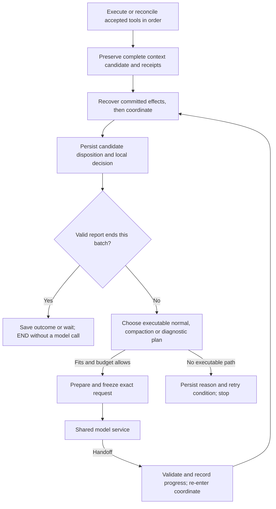

> Revision basis: the adopted design and recorded corrections below retain their original identities; this filing is not new adoption. [Decisions](../decisions/CONTEXT_MANAGEMENT.md#context-coordination-design-recording-boundary), [discussion](../discussions/CONTEXT_COORDINATION.md#d20-human-adopts-the-integrated-design-and-authorizes-recording), [captured shared contract](../history/contracts/20261031_0157_CONTRACTS.md#q2-context-transitions), [captured requirements](../history/contracts/20261031_0157_PRODUCT_REQUIREMENTS.md) and [captured architecture](../history/contracts/20261031_0157_ARCHITECTURE.md) identify the applicable basis. Exact prior design identities not recorded remain unknown; current readiness is separate in [CURRENT_STATE](../CURRENT_STATE.md).

# Context update coordination: consolidated target design

Updated 2026-10-26, Asia/Hong_Kong (UTC+08:00). Application baseline `a484b9b` and design checkpoint `c1e6fcc` precede the complete coordination implementation. This document retains the adopted design and rationale; [CONTRACTS Q2/Q3](CONTEXT_MANAGEMENT.md#q2-context-transitions) owns effective behavior and [recorded implementation result](../history/IMPLEMENTATION_HISTORY.md#complete-context-update-coordination) owns actual checks and limits.

**Status: the four human-selected policies and integrated design are implemented under the subsequent explicit implementation instruction.** D15/D18/D20 retain the adoption sequence in the [discussion record](../discussions/CONTEXT_COORDINATION.md). Implementation does not turn scripted validation into proof of autonomous PDF quality; Stage B remains separately authorized.

## Guide navigation

Read the relevant mechanism below with [current contracts](../CONTRACTS.md#reading-this-contract) and [current verification](../CURRENT_STATE.md#verification-basis). Historical alternatives and original implementation-order proposals retain their stated status.

Sections in this guide

- [Purpose, scope and policy choices](#purpose-scope-and-policy-choices)
- [Preserved requirements](#preserved-requirements)
- [State and authority](#state-and-authority)
- [Four decision responsibilities](#four-decision-responsibilities)
- [Batch composition and tool contract](#batch-composition-and-tool-contract)
- [End-to-end flow and decision conditions](#end-to-end-flow-and-decision-conditions)
- [Request plans, projections and estimation](#request-plans-projections-and-estimation)
- [Result presentation and original receipts](#result-presentation-and-original-receipts)
- [Persistence, interruption and recovery](#persistence-interruption-and-recovery)
- [Implementation route, if authorized](#implementation-route-if-authorized)
- [Observable acceptance and limits](#observable-acceptance-and-limits)

## Purpose, scope and policy choices

An agent's supported context update must have a complete path: validate and preserve it, decide whether it can become effective, organize history when useful, retain a precisely described wait when external conditions are missing, or return an actionable non-admission result while preserving useful work. Capacity protection alone is insufficient if the agent can never receive the result or revise the candidate.

This design covers context composition, request projection, compaction, proposal disposition, result delivery, and directly related tool-batch/checkpoint/reopen boundaries. It does not add OCR recovery, export portability, Alpha handling, packaging or provider experiments. No backward compatibility constraint justifies keeping an unsuitable internal structure; existing originals, useful documents and historical effects still require protection.

| Consequential choice | Selected target | Cost and decision status |
| --- | --- | --- |
| Capacity and commit unit | Compose all context updates from one completed accepted tool batch, then admit its final candidate as a whole | Selected 2026-10-25. An otherwise fitting update waits until the batch completes. No extra model call is required for local coordination. |
| Structural failure inside that context revision | Do not automatically apply a valid prefix or fall back to an older pending candidate; retain all reusable content for an explicit agent revision | Selected 2026-10-25. Independently useful changes can wait with dependent ones. Other successful tools are not rolled back. Temporary historical pressure does not invalidate a legal candidate. |
| New human instructions after an interrupted batch | Restore committed effects; stop automatic admission of uncommitted intent and let the agent explicitly reuse content in a new revision under the new instructions | Selected 2026-10-25. Even a small amendment requires reselection of uncommitted intent. No routine human approval is required. Frozen/accepted request boundaries remain protected. |
| Confirmed necessary-content excess (B) | At an applicable unfrozen decision boundary, record a complete, valid, still-eligible candidate as `needs_agent_revision` when its necessary content is confirmed over the current allowance | Selected 2026-10-25, irrespective of prior fit or diagnostic deliverability. Preserve content, A and useful work. A later capacity increase does not undo the disposition. Unknown estimates and reducible history pressure do not establish this excess. |

The current immediate/deferred dual path has real advantages, especially early commitment before Stop. An improved version could retain intermediate `X+Y`, compose a later release of X, and admit Y; failure of the current per-call core check does not prove that every immediate/deferred design fails this case. The selected batch policy instead protects the case where an early fitting notes update could commit before a dependent pin fails. These are distinct policy tradeoffs, not proof that the existing committed/uncommitted distinction is contradictory. [The alternatives](../discussions/CONTEXT_COORDINATION.md#alternatives-and-current-disposition) retain the comparison. Commit timing, raw receipt format, outcome placement and model-call count remain separate decisions.

## Preserved requirements

- The agent chooses methods, tools, evidence, representations and reconstruction scope. No fixed conversion recipe, automatic pin downgrade, silent release, reduced fidelity or narrower user scope is introduced.
- Keep sources, native responses, exact tool arguments/results, candidate policies, useful failed handoffs and document versions. Preserve first/full/raw/field/range/native-pixel access. A reference, summary or application receipt is not source coverage or content acceptance.
- Commit a policy only after complete normal-input admission. Non-admission preserves the active policy and successful document/tool effects. Saving an intent, committing a disposition, applying a policy and presenting an outcome remain different facts. A committed needs-revision disposition is not an applied policy.
- Do not rewrite original receipts. A needs-revision, rejected, withdrawn or superseded revision cannot revive automatically. Reusing its content produces a new revision and decision. Under the selected whole-batch policy, do not apply only the fitting part of a context revision.
- Preserve valid human instructions, consumed requests/time, frozen payloads/routes and replay limits. Coordination itself requires no model call. Compaction and repair share the existing durable execution budgets.
- Do not add a general rule that temporarily uses every shorter pending pin or note. Shorter content need not be semantically equivalent or separable from the other changes in its revision.

## State and authority

These names describe responsibilities, not mandatory tables or public field names. Existing graph state, immutable records and short SQLite transactions remain the starting point. A framework replacement or fixed table-count restriction is not selected.

| Symbol | Meaning and authority | Required basis |
| --- | --- | --- |
| `A` | Active context policy: notes, pins, representations and releases | Graph execution uses its small policy projection. A durable accepted application effect establishes which transition happened; recovery reconstructs that effect rather than voting between two policy stores. |
| `Q` | Immutable candidate revision and its ordered context operations | Candidate/base identity, accepted batch and operation identities, exact arguments, instruction basis, validation result, composed policy if valid, and current disposition. Stored bytes alone do not establish eligibility. |
| `H` | Retained active history and complete original records | Accepted native responses and paired tool receipts; exact covered/remaining identities. Projection may defer a body but keeps its original and access reference. |
| `S` | Accepted handoff, plus separately retained unapplied handoff candidates | Application receipt, covered prefix, prior handoff/revision, exact archive and continuation facts. An archive is not proof of application. |
| `E` | Current evaluation conditions | Instructions, document head, route/capacity/image settings, output allowance, consumed budget, repair episode and task/report status. Distinguish changed conditions from changes to historical effects. |
| `F` | Frozen request | Exact native payload, route, source revisions, logical request identity and attempt state. Prepared, attempted and accepted-response states are distinct; freezing is not sending. |
| `O` | Settlement and required outcome presentation | Immutable decision/effect with candidate and operation references; separate evidence of inclusion in a request. Inclusion does not prove that a model understood the result. |

There is one policy-commit authority. `Runtime.tools` preserves and composes; the coordinator decides and commits; graph state reflects a recorded effect. The document engine remains authoritative for its own versions. Successful `edit_document` effects are not rolled back because a context candidate fails.

### Saved, applied, disposition and continuation

**Saved** means exact content and its origin can be recovered and read. It is not a promise of execution eligibility and does not make the proposed policy part of model input. **Applied** means a specific complete candidate passed admission and its policy transition was durably committed. The next permitted request uses the committed policy; a previously frozen request is never rewritten. A durable effect may exist before its graph projection or agent-facing result is updated.

The batch is the ordered calls from one complete accepted model response. While that batch is incomplete, saved context operations are collecting work, not an admissible partial revision. A batch being complete, its candidate being eligible, its policy being applied, and its outcome being included in a model request are four different facts.

| Candidate disposition | Automatic admission | Meaning on re-entry |
| --- | --- | --- |
| `collecting` / incomplete batch | Not allowed | Restore saved operations and eligible remaining calls; never admit a partial batch. |
| `eligible_pending` | Allowed when the basis remains valid | Re-evaluate the recorded candidate after the relevant history/settings condition changes. It may now fit without compaction. |
| `needs_agent_revision` | Not allowed | The current attempt needs an explicit agent decision; content remains useful. Present the diagnostic under `A`. Repair or reselection creates a new revision; more capacity alone does not change this disposition. This is not a terminal rejection of the reusable content. |
| `applied` | Already completed | Restore the committed effect once. Do not repeat or revoke it because today's settings differ. |
| `rejected`, `withdrawn`, `superseded` | Not allowed; terminal for that revision | Preserve the final decision and any undelivered outcome. Reuse content only through a new revision. |

Validation can separately identify `invalid_revision`; an individual malformed operation has its own validation receipt. A Boolean such as `auto_admit` may be derived from disposition, but cannot replace the distinction between needing revision and being terminal. Store the reason and the instruction/base revision that justified the decision.

Candidate content is immutable. Execution eligibility is derived from a recorded disposition and valid basis, not a second independently writable policy flag. Later decisions reference that content; they do not rewrite its parameters, original validation receipt or instruction basis. Terminal means that the particular revision is closed, not that its bytes must be deleted or cannot be selected again. The design maps the selected new-instruction rule to `superseded(reason=new_instructions)` for the old uncommitted revision. That label describes lost execution authority, not proof that every old note or source fact is wrong.

Waiting belongs to the continuation plan. It records the attempted action, obstruction, relevant evaluation basis and condition for retry. For example, `eligible_pending + capacity_blocked` is different from `needs_agent_revision + feedback_capacity_blocked`. A later capacity increase may admit the first; it only enables feedback for the second.

An unknown image cost, missing capacity setting or estimation failure is not a measured over-capacity result. Keep that uncertainty explicit. Do not silently treat `core.fits == false` as encompassing both known excess and unknown feasibility.

### Capacity classification and policy B

B is selected. At an applicable decision boundary with no conflicting frozen-request obligation, first recover any committed effect, check the instruction/base validity and complete the accepted batch. For a final structurally valid candidate, confirmed necessary-content excess under current settings produces a durable `needs_agent_revision(reason=required_content_exceeds_capacity)` disposition. It does not depend on whether the candidate previously fit, what caused the capacity change, or whether A can carry the diagnostic. Retain A, Q, history and all successful artifacts. Increasing capacity after this disposition cannot restore automatic eligibility.

| Observation or recorded decision | Target disposition/action | Capacity repair or reopen |
| --- | --- | --- |
| Complete valid Q and its actual full normal plan fit | Commit `applied` and the policy transition with the evaluated basis | Restore the committed effect; do not re-admit it under today's settings |
| Q is valid; history or handoff prevents full admission, without proof that necessary content alone exceeds capacity | Keep `eligible_pending`; evaluate actual compaction under A and the intended Q continuation | Recheck full admission after accepted progress or a relevant setting change; compaction success is not admission |
| Necessary content of a still-eligible final Q is confirmed over allowance | Commit needs revision under B before planning notification | Reopen continues diagnosis/reselection, not Q admission, even after capacity increases |
| Required settings or representation costs are unknown | Keep uncertainty explicit; preserve eligibility while waiting for a named configuration condition | Do not classify an estimate failure as confirmed excess. If control is instead returned to the agent for a new choice, first record that transfer as needs revision with its distinct reason, then deliver the diagnostic |
| Actual compaction cannot execute, without a separate invalidity or excess decision | Preserve eligibility and record the concrete obstruction | Replan only after a relevant condition changes; unchanged retries do not constitute progress |
| A structural error invalidates the batch revision | Record needs revision; disable automatic fallback to an older pending revision, with a durable reason/link | More capacity does not repair parameters or reconfirm old intent; select content in a new revision |
| Needs-revision or terminal O exists, but A cannot carry its diagnostic | Retain O; record feedback obstruction separately | Capacity repair can enable feedback, never automatic application of Q |
| New instructions, explicit replacement or withdrawal end uncommitted intent | Record superseded/withdrawn or the appropriate terminal disposition without rewriting its basis | Reuse requires a new explicitly selected revision |

Settings changes do not themselves reclassify a candidate. If capacity falls and returns before any new disposition commits, an eligible candidate is evaluated against the then-current settings. If B committed during the lower-capacity interval, restoration does not undo it. Pressing Continue is not the disposition boundary.

Unknown settings cannot be invented by the agent. Where a usable A request exists, the app can return the choice during normal agent work: durably transfer Q out of automatic admission before presenting it for revision. The reason is unresolved feasibility/agent choice, not measured excess. Otherwise preserve an explicit configuration wait. Do not leave automatic Q admission racing with an agent revising the same intent.

**Current-code distinction:** at `a484b9b`, `ContextUpdates.resolve()` checks the active-policy fallback before committing a capacity rejection; if that check stops, it saves a waiting observation. Later admission on that path is not revival of a committed rejection. B intentionally changes that policy responsibility and the related capacity-wait tests. Existing committed settlements still recover before new decisions. [CONTRACTS Q2](CONTEXT_MANAGEMENT.md#q2-context-transitions) now describes B and complete-batch commitment; the previous paragraph explains the intentional change from the baseline.

## Four decision responsibilities

| Responsibility | Question it answers | Intended component boundary |
| --- | --- | --- |
| Compose and validate | What exact context revision did the ordered operations propose? | Tool dispatch/composition; no per-operation capacity veto against an intermediate candidate |
| Project and estimate | What would this particular native request contain and cost under one snapshot? | `Context` and shared protocol assembly; purpose-specific plans with common cost/projection principles |
| Decide and plan continuation | Is this revision eligible, admitted, in need of revision or terminal; what executable action follows? | `ContextUpdates`/`coordinate`; disposition independent of notification feasibility |
| Commit and recover | Which effect has durably happened and which work remains? | Existing immutable records, catalog transactions and graph checkpoints with explicit replay bases |

Centralization means one decision authority, not one helper that forces every stage to use identical content or the same reserve.

## Batch composition and tool contract

Only an accepted complete model response supplies executable calls. Preserve call order and original operation identities; reconcile durable results before re-executing tools. Do not admit partial/cross-attempt model output.

For each context operation, validate parameter shape, allowed representation, reference existence/identity and selected field/range. Preserve its exact input and original result. Compose structurally valid changes in order, without rejecting a temporarily large intermediate policy. Actual native tool results and the post-batch document state must be known before full capacity admission.

Examples:

- Starting with large image `X`, `[pin(Y), release(X)]` is tested as the final `Y` policy. An intermediate `X + Y` excess does not remove the first operation.
- `[notes("Use Y to check the table"), pin(Y)]` is one context revision. If the final candidate cannot be admitted, the app does not automatically activate only its notes.
- If the second context operation has an invalid range, retain both inputs and diagnostic results, but do not commit the first operation as if independence were known. Successful document edits in the same batch remain saved.

Retain existing ordered value semantics: omitted notes leave them unchanged; a string replaces the whole notes value; `""` clears it; `null` is invalid. Within a single update, release precedes pin, so explicitly re-pinning the same reference wins and installs the selected representation/range. Across operations, accepted order determines the composed policy.

The proposed base selector is `base="pending" | "active"`:

- `pending` starts from an eligible pending candidate, otherwise from `A` when there is no candidate. Later operations compose on the current batch's working candidate. A stored ineligible/terminal candidate must not be silently reused or revived; report that an explicit new decision is required.
- `active` explicitly abandons the pending lineage as an automatic candidate and resets the current batch's working candidate to `A`. Subsequent operations compose from that reset. The completed batch still produces one final candidate revision, not separate commits before and after reset. Preserve abandoned/earlier content and outcomes; if the final revision is invalid, do not restore an abandoned candidate's automatic eligibility.
- Reusing an ineligible candidate requires an explicit new revision referencing the chosen content and current basis. The implemented fields are `base: {kind, ref}` and `reuse: [{ref, operations?, fields?}]`; overloading an ordinary omitted base to mean reconfirmation is not acceptable.

If a later update invalidates the batch's context revision, preserve the previous pending candidate's bytes but suspend its automatic admission. A failed attempt to change intent is not permission to execute a stale fallback. A valid explicit reset is distinguishable from a malformed request that never established a reset instruction.

Raw receipts describe what was known when the operation ran: saved/validated, invalid or unexecuted. Settlement describes the formal result of the complete revision. Presentation may report the later result alongside a raw receipt, but must not mutate it or imply every intermediate pin/note was individually active.

### Explicit reuse without restoring old execution authority

The agent may read and explicitly select retained content under its current instructions. It does not need a user approval for each selection. The fresh operation records source references, the current instruction basis, its chosen base and ordered changes. Revalidate ownership, references, selections and the final composed policy; the batch still needs full admission. Never dispatch a failed/old tool call solely because its arguments still exist, and never resurrect an old proposal or rewrite its basis.

The adopted reuse semantics are **selected context operations or fields applied to an explicit current base** (`active` or an eligible pending candidate), with exact source references. Reusing the notes field does not implicitly reuse old pins, releases, document edits or a report. An explicit selection of an operation sequence preserves its order and undergoes validation again. This lets the agent repair a pin and reuse saved notes within one fresh batch. It also permits the agent, rather than the app, to select an independent subset.

Importing a complete old policy snapshot would instead replace notes and selections with that snapshot and could undo later context choices. It must never be an implicit interpretation of a generic `proposal_ref`; if offered later it needs its own explicit replacement semantics. The adopted design does not add that mode. The implemented tool validates explicit source selections and expected current base references; operation reuse and snapshot replacement cannot be silently interchanged.

A reuse reference identifies the source candidate/operation, selected operations or fields, and the expected current base identity. Selected operations retain their original relative order; multiple selections follow the explicit new request order, followed by its new changes. A stale expected base returns a conflict instead of silently rebasing and overwriting later choices. Revalidate source identity/ownership, reference existence, representation, field/range and the final native input. A parseable field from structurally invalid saved content may be selected and repaired; malformed raw input remains readable but is not guessed into valid operations. The new revision records `reused_from`, its own operation identities and current instruction basis.

Ordinary `base="pending"` is not explicit reselection of an ineligible candidate. Return an actionable diagnostic instead of silently reusing it or falling back to A. An explicit `base="active"` starts from A and records abandonment of the old automatic lineage; a malformed request does not silently establish that reset. Subsequent valid calls do not silently rehabilitate a structurally invalid batch: retain their content for a new revision. None of these rules roll back already successful non-context tools.

Reuse can reduce repeated output but is not zero-cost or a guarantee of no additional agent turn. Local coordination requires no model call; the agent can reselect during its next normal decision rather than through a compulsory confirmation-only call. Whether that path is usable still depends on an actual fitting A-plus-diagnostic plan and remaining budgets.

## End-to-end flow and decision conditions

The graph need not be rewritten wholesale. The meaningful change is that a completed tool batch reaches local coordination before either `prepare` or `END`; terminal routing cannot bypass a necessary decision. A stopped incomplete batch keeps saved operations but is not a complete candidate commit.

1. **Recover before deciding again.** Reconcile an existing committed settlement/handoff/tool effect using its original basis. Preserve an existing frozen logical request's execution boundary. Fresh settings and amendments govern new decisions, not a reclassification of historical success.
2. **Establish validity.** Under the selected policy, new user instructions end the old uncommitted candidate's automatic eligibility at the permitted transition; record supersession and retain content for a fresh agent selection. Do not infer harmless amendments or rewrite `instruction_basis`. Apply the batch/structural-failure rules before capacity planning.
3. **Test complete candidate continuation only when eligible.** A newly validated complete candidate or an existing `eligible_pending` candidate can enter admission. With one snapshot, build its full normal plan under `Q` including the actual prospective applied outcome. If it fits without gaining room through additional unselected evidence deferral, record application and make `Q` the new `A`. Needs-revision or terminal candidates go to their diagnostic path even when more capacity would now fit them.
4. **Classify non-admission independently of delivery.** An invalid revision requires an agent decision, durable even if A cannot deliver the diagnostic. A still-eligible candidate impeded by history remains pending. Apply B when the necessary-content test proves excess; commit that disposition before diagnosing. Historical pressure alone retains eligibility. Do not infer excess or a terminal decision from a generic `fits=False` or an unknown estimate. Once a disposition is recorded, delivery failure does not change it back to eligible waiting.
5. **Respect an accepted terminal report that is valid for the current instructions.** Finish local recording and honor `report(complete/partial/waiting)` in every branch. A candidate that would need compaction, revision or settings remains accurately recorded; no unused next model request is required. An old report receipt does not end a newly amended task merely because it was once accepted. A valid current report is not changed into a capacity error. Actual persistence failure or invalid report content is still an error. A report alone is not independent fidelity certification.
6. **When continuation is needed, choose an executable plan** using the table below. Persist a useful wait if there is no such plan; do not equate storing `waiting` with solving the capability gap.

| Situation | Next action | What re-entry may do |
| --- | --- | --- |
| Applied candidate | Prepare normal work under new `A`, with required outcome | Recover the existing effect, not apply it again |
| Eligible candidate, history prevents full admission | Test the actual compaction plan under old `A` and permitted projection; execute only if it fits and budgets/content permit | Re-admit after accepted progress; continue rolling compaction if useful |
| Eligible candidate, actual compaction exceeds allowance | Wait with exact obstruction and candidate preserved | Re-evaluate after a relevant external condition changes; no promise that waiting alone helps |
| Missing settings or unpriced representation | Wait for the named condition, or durably transfer control to the agent when a usable A request exists | Rebuild an estimate while still eligible; after transfer, require an explicit new revision. Neither path invents configuration or claims measured excess |
| Needs revision or terminal result awaiting presentation | Test actual `A + diagnostic`; if history is the obstacle, test actual compaction under A and its reachable diagnostic target | Present the recorded decision; never auto-apply Q or borrow its releases. If required diagnostic content is itself over allowance, do not spend compaction calls on an unreachable normal target |
| No progress or exhausted handoff correction episode | Preserve history/candidate and record the specific reason. If candidate-specific repair is exhausted and `A` can continue, require a new agent revision and deliver its diagnostic | Do not rename this as a settings failure or replay the same exhausted repair automatically |
| Task request/time budget exhausted | Persist disposition and required action; stop inference | Preserve consumption; only a separately authorized total-allowance change can permit more work |

A required-content proof is one-way, as specified below: absence of proven excess does not prove the final continuation can fit. Planning can remain uncertain and bounded compaction can fail to find a sufficient handoff.

Outcome delivery under `A` must be a real route through `prepare`, even while the ineligible candidate remains retrievable. A blanket rule that any saved candidate blocks all normal work would defeat agent correction.

## Request plans, projections and estimation

A plan identifies purpose, the exact evaluated snapshot, policy/handoff/history basis, result presentation, native payload, cost breakdown, output allowance and evidence projections. These are semantic contents, not a mandatory class or serialized schema. Estimate and freeze the same selected plan; if its basis changes before freezing, rebuild it. Never rebuild an already frozen request to incorporate a later choice.

| Plan | Policy and content | The question being answered |
| --- | --- | --- |
| Normal candidate continuation | Final `Q`, current `H/S`, actual applied outcome, current anchors/tools/images | Can this revision commit and allow normal work now? |
| Actual compaction | Active `A`, exact selected history/handoff, compaction instructions and explicitly permitted compaction projection | Can this organization request itself execute? |
| Post-handoff continuation | Candidate handoff plus remaining history, target `Q` or `A`, corresponding specific outcome | Does this handoff permit the intended next decision, or provide acceptable incremental progress? |
| Diagnostic continuation | Active `A`, current `H/S` and specific non-admission/terminal outcome | Can the agent receive the result and make a new choice? |

All plans use the selected protocol's actual assembly and common positive-savings principles, including tool descriptions, native pairing/envelopes, image/base64 treatment and output reservation. The shared request proxy and its explicit fallback are described in [complete-request capacity accounting](../guides/CONTEXT_AND_EVIDENCE.md#capacity-accounting). They are admission reservations, not provider-token bounds. Missing image/modality/protocol configuration remains visible.

### Necessary-content proof and complete-input admission

Do not obtain the necessary-content decision merely by emptying `history` and `handoff` in `normal()`. Removing them from an estimate can erase unfinished work, dependencies, cautions, outcomes or protocol context that must survive. The actual normal plan retains these facts through the accepted H/S and current anchors. Only an accepted replacement may retire the covered historical projection; complete originals stay accessible.

Use three distinct observations from the same assembly/cost responsibility: the complete purpose-specific request reservation; the mandatory-content projection with unreserved proxy and reservation; and independently justified minimum-cost evidence, if any. Current local profiles supply the first two, not the third: `proof_available=false`, nullable `necessary_cost_lower_bound`, `proved_excess=false`. A smaller projection, a tokenizer count of serialized JSON, a configured image allowance or removal of a safety margin does not establish a real token lower bound.

A failing mandatory reservation is `necessary_estimate_uncertain`. A real fitting active-policy diagnostic can transfer choice with a durable uncertainty disposition; if that diagnostic cannot fit, retain eligible intent with a named wait. Neither branch reports confirmed necessary-content excess. A fitting mandatory projection does not prove a semantically sufficient continuation fits; complete actual admission remains mandatory. The selected policy B continues to govern independently supported proof and historical committed results; no new proxy-based proof is manufactured.

For a prospective or committed settlement, measure the actual selected presentation. Inline/separate outcomes differ; an optional larger placement is not a universal minimum. Omission from the mandatory projection does not authorize omission from the complete input. Existing unfrozen eligible waits use the current estimator; committed dispositions/handoffs and frozen requests retain their historical settlement and identity.

**Known result versus unknown result:** when testing a particular applied/rejected/superseded outcome, preview the exact presentation that the selected plan would contain. When the outcome is genuinely undecided, a bounded reserve can plan space for likely control messages. It is not a lower-bound proof that the candidate itself is impossible, nor part of a compaction envelope that will not send that control message. Do not fix disagreement by adding constants or deleting all reserves.

The three confirmed context-capacity findings at `a484b9b` become these responsibility rules:

- **CC-R1:** inability to fit normal input under old `A` plus a future outcome reserve does not prove that actual compaction is impossible. Check actual compaction and retain its own capacity guard. Do not borrow shorter pending notes/views to conceal the wrong gate.
- **CC-R2:** the same target snapshot and outcome presentation must yield the same preview at final-handoff acceptance, admission and preparation. Different purposes may legitimately have different estimates. The observed 60-unit discrepancy is a regression fixture, not a new fixed allowance.
- **CC-R3:** reference substitution counts as savings only if it shrinks the actual caller-native projection. Share this principle between normal admission and compaction-prefix progress; short arguments that grow as references cannot cancel a useful result-body reduction. No original is removed.

### Compaction acceptance

Use the active policy and the already explicitly allowed pending-release projection, labelled with its source and limited to an eligible candidate. This is a temporary compaction view, not partial policy commitment. First use the actual old-policy compaction feasibility already supported by the controls; do not add new temporary shrink rules. Do not borrow releases from an ineligible/withdrawn proposal for the `A + diagnostic` fallback. Do not introduce general temporary shorter pin/notes substitution without separate evidence and policy selection.

Preserve the original native response, useful handoff candidate and exact covered prefix before acceptance. Validate required fields, references, basis/revision and protocol structure. Require strict positive reduction on a comparable before/after projection. With uncovered history, useful partial progress can be accepted even when normal work still does not fit. A handoff may itself need further reduction. Do not add an arbitrary compaction-count limit.

A fitting compaction request does not guarantee a fitting normal request. With an eligible Q the target is Q plus the specific applied outcome; old A normal-input excess is not the same target. After B the target is A plus the recorded diagnostic. If an independently supported minimum exceeds allowance, retain the disposition and use the confirmed obstruction boundary. Under the current proxy, a failing mandatory reservation instead stops with `necessary_estimate_uncertain`; it cannot establish that shrinking history is mathematically futile. Bounded actual compaction is available for history pressure when the mandatory reservation fits; success still requires the complete target plan to fit.

For the last covered history, evaluate the actual intended continuation, including its candidate policy and specific settlement presentation. Reject an insufficient handoff through the existing bounded correction episode while retaining the old active history and failed candidate. Exhausted correction is not automatically permanent candidate invalidity: distinguish a candidate that now needs an explicit new decision from lack of budget or any usable compaction path. Preserve task-level attempts/time and per-response repair scopes; switching to diagnostic delivery cannot reset or silently bypass either.

## Result presentation and original receipts

The presentation decision is made against the actual emitted messages for one request. If those messages already contain the settlement's complete necessary result in an appropriate tool-result projection, do not append a duplicate outcome message. Otherwise include the required bounded outcome and exact reference in the normal input.

Membership of the source request in stored history is insufficient. Partial compaction can leave the latest batch while a particular outcome is absent from its emitted projection. Conversely, crossing a wait does not automatically require a second copy. Track which settlement the projection actually represents; retain the full result for exact retrieval. The estimator must account for the selected presentation, not assume zero overhead or a universal 251/280-byte surcharge.

Describe an inline applied result as “this operation is included in candidate revision Q committed by settlement O.” Do not claim an intermediate `pin(Y)` was active if later operations removed it before the final commit. Native pairing and immutable raw receipts remain intact.

A frozen payload never receives a retroactive result overlay. A result can be saved, included in a prepared request, attempted, and followed by an accepted response at distinct times. Avoid a `delivered=true` flag whose meaning alternates between those facts. Existing receipts/requests may encode them; no additional delivery table is prescribed.

## Persistence, interruption and recovery

Catalog transactions, immutable files and graph checkpoints do not form one distributed transaction. Writing an object file alone is not a committed disposition. Register the decision/effect and eligibility transition with stable identities and an expected evaluation/base revision in a short metadata transaction; graph state then projects that record. A pre-commit basis change requires replanning. A post-commit graph delay requires recovery of the existing effect, not a second decision. Exact storage fields remain an implementation choice. Stable operation/candidate/settlement/request identities and recorded bases bridge those boundaries. Do not rely on process memory, timestamps, a larger policy revision number or automatic retry of every failed record to infer intent.

| Durable point before interruption | Required recovery |
| --- | --- |
| Some tool operations saved; batch incomplete | Recover exact completed effects/receipts and resume eligible remaining operations. Do not commit a partial context revision. Plain Continue preserves the accepted batch; new instructions follow the selected supersession rule and skip obsolete unstarted calls. |
| Complete candidate saved; no settlement | Recover candidate and disposition, validate current basis, then plan the next action. Ineligible content is readable but not auto-applied. |
| Handoff candidate saved; no accepted application | Retain it as useful content; perform the required validation before applying. |
| Accepted handoff application saved; graph not updated | Restore its recorded covered history/handoff once before evaluating new conditions. |
| Policy settlement committed; graph not updated | Restore the exact effect and outcome using its recorded basis, including effects committed before new instructions. Do not rerun admission using today's capacity. |
| Needs-revision/terminal O committed; no fitting delivery plan | Restore O first, retain A/Q and resume the recorded diagnostic action. Later capacity repair can deliver the result; it cannot re-admit Q. An eligible wait without such a disposition remains separately re-evaluable. |
| Request frozen/prepared, attempted or response accepted | Follow the original execution/replay boundary for that state. Do not equate a freeze with a send, change payload/route during replay, reset usage or execute partial responses. |
| Terminal report accepted | Recover local context decision/wait and document effects; end if the report is still valid for current instructions. An obsolete historical report cannot end an amended task. Reopen alone does not call a model. |

A settings or instruction change cannot rewrite an existing F. An amendment that invalidates a prepared-but-unsent continuation follows the existing supersession rules and uses a new request identity; the old prepared payload remains preserved. Attempted/accepted requests retain their original replay and effect boundaries. Known consumption and bounded repair state are never reset by reopening or by changing the next plan purpose.

Existing immediate admitted tool receipts are historical completed effects and must still recover as such. A future saved-but-uncommitted batch is a different commitment. If implementation changes the cancellation tests to this target, make the policy change explicit; do not rewrite the old evidence as having tested the new semantics.

### Representative decisions through reopen

| Scenario | Active/candidate state and promise | Agent result and reopen behavior |
| --- | --- | --- |
| Pin Y, then release X; only final Y fits | A retains X during ordered composition of Q as X+Y then Y. Admit only the completed Y candidate. | Report the final batch effect, not intermediate pin activation. Restore a committed settlement once; if only history blocks it, organize under A and target Q. |
| Notes depend on Y, then invalid pin Y | A remains unchanged. Save all inputs; the whole revision needs repair and older pending fallback loses automatic eligibility. Successful document edits remain. | Diagnose under A; agent may reuse exact notes plus a repaired pin in a new revision. Reopen applies neither the notes alone nor the old fallback. |
| Valid Q fits in principle; history/handoff causes pressure | Q stays eligible; keep A effective while actual compaction makes accepted progress. | One or several useful reductions may lead to full admission within existing budgets. An insufficient final handoff is repaired boundedly, not counted as completion. |
| New Q has confirmed necessary-content excess | Record needs revision under B first; preserve A and Q. | Deliver the specific diagnostic under A, directly or after useful A compaction. Agent chooses a new representation/range or other revision; app never substitutes one. |
| Capacity falls, then returns before a new disposition commits | Q remains eligible unless another validity event occurred; a transient observation is not a committed disposition. | Evaluate against current settings at the next applicable unfrozen boundary. Plain Continue is not itself a decision, and original-capacity restoration does not guarantee the full request fits. |
| Capacity falls, B commits, then capacity returns | Q remains needs revision even if it previously fit and now fits again. | Capacity helps diagnostic delivery. Explicit new selection creates a new Q; restoring settings cannot undo O. |
| Q needs revision; A diagnostic has only historical pressure | O remains committed, A unchanged. Check real A compaction and its post-handoff diagnostic target, without Q releases. | Continue boundedly to diagnostic and agent repair if those plans fit. Recover accepted handoffs and O before new planning. |
| A compaction fits but diagnostic necessary content is over capacity | O remains committed; no history reduction can make that normal target fit. | Record feedback obstruction and needed external configuration/capacity or authorized instruction condition. Do not spend calls to simulate progress. |
| Neither A diagnostic nor actual permitted compaction can execute | Preserve O/A/Q, originals and useful work; report the concrete capacity, configuration or budget blocker. | Reopen or plain Continue cannot create capacity. Recheck after the named condition changes; do not automatically apply Q. |
| Stop after the first saved update; plain Continue | Saved work is collecting, not a partial context commitment. Earlier committed effects remain authoritative. | Recover completed calls, execute eligible remaining calls, then coordinate the complete batch. Consumption is unchanged. |
| Same Stop; new instructions before Continue | Restore committed effects; supersede uncommitted intent without rewriting its original basis; skip obsolete unstarted calls. | Present current instructions, dispositions and reuse references in the next permitted request. Agent may establish a new revision; old intent never revives. |
| Settlement/handoff committed before graph checkpoint, or F already exists | Durable effects and frozen request identities establish the relevant boundaries. | Restore committed effects once before fresh decisions; retain exact frozen bytes/routes and attempt state. Do not re-admit historical effects under new settings. |

Recovering a committed pin does not require it to remain selected forever: the agent may change A through a new admitted revision. A wait is honest preservation, not evidence of autonomous continuation. Reopen alone never starts inference; normal Continue respects existing execution authorization, remaining budget and frozen-request rules. Other tools' successful edits or evidence artifacts are not rolled back by any context disposition.

## Implementation route, if authorized

The heading is retained as a stable discussion link. The following route was subsequently authorized and implemented; this section explains its responsibility boundaries.

These were ordered milestones inside the authorized context-update capability:

1. **Request and decision foundations.** Separate actual normal, compaction, diagnostic and post-handoff plans; retain exact specific-outcome preview and common positive-savings principles. The original milestone included a supported necessary-cost proof; the later R01 correction established that the implemented local profiles supply estimates, not such a proof. Keep snapshot, purpose and uncertainty explicit, as specified under [request plans and estimation](#request-plans-projections-and-estimation). CC-R1/2/3 remain regressions, not the whole scope.
2. **Whole-batch disposition and commitment.** Context tools capture/validate/compose without intermediate capacity commitment. A single coordinator handles complete-candidate validity, B, admission, waiting and terminal-report routing. Persist decisions before graph projection; preserve other tool effects, raw receipts and frozen boundaries.
3. **Agent correction and recovery through delivery.** Implement selected-content reuse, diagnostic continuation, settings/amendment interactions and effect recovery. Exercise the complete Runtime and saved/reopened/exported paths below, then update effective CONTRACTS/ARCHITECTURE and affected tests in the authorized implementation batch.

Keep the small StateGraph, Nexus service, immutable objects, SQLite catalog and document/evidence engine as a useful baseline: they already supply identities, execution boundaries and saved artifacts. Replace scattered application decisions and inconsistent request construction. A framework replacement, new table count or extensive transient shrink manager is not required by the evidence. Change internal boundaries if needed to implement these responsibilities correctly. Consult installed-version official guidance for an uncertain API without automatically upgrading.

The concrete implementation uses `ContextRevisions`, `Context`, `ContextUpdates` and Runtime coordination. The catalog records `context_disposition`, `context_commit` and `context_policy` are metadata within the existing store, not separate databases. `required()` returns the mandatory projection, unreserved proxy and reservation with named exclusions, `proof_available=false`, `necessary_cost_lower_bound=null`, `proved_excess=false` and `proves_full_admission=false`; only complete native-request admission can apply a policy. This is the R01-corrected implementation, superseding the earlier lower-bound characterization without removing policy B's conditional independently-proved-excess rule. These choices implement the adopted semantics. Effective contracts and evidence remain in their primary owners.

## Observable acceptance and limits

The matrix below defines acceptance. [recorded implementation result](../history/IMPLEMENTATION_HISTORY.md#complete-context-update-coordination) and the [review handoff](../REVIEW_HANDOFF.md) identify executed checks; a row here alone is not a passing result. Use both Chat Completions and Responses with local scripted replies/mock transport before proposing live work. Preserve unchanged capacity in shrinking-update cases.

| Capability | Observable acceptance |
| --- | --- |
| Feasible shrinking updates | Full to index, full to precise range and shorter notes survive historical pressure, compact under old policy when feasible, commit after actual admission and continue useful work without increasing capacity. |
| Real compaction obstruction | A genuinely oversized actual compaction request stops with an exact reason and retry condition; policy, candidate, history and documents remain intact. Unknown estimation/configuration is reported separately. |
| Final-result consistency | A fitting particular applied settlement is not rejected by an unrelated unknown reserve. Unknown/rejected/superseded presentation still has correct capacity accounting. |
| Positive projection | Short-argument expansion cannot erase result-body savings or unnecessarily absorb the next evidence batch in the retained CC-R3 control. |
| Final candidate and dependencies | Pin Y then release X succeeds when only final Y fits. Notes referring to Y plus an invalid pin does not partially apply. Release/re-pin, note omission/replacement/clear and same-reference representation changes retain their ordered meaning. |
| Invalid revision and reset | Failed later updates preserve earlier content but cannot automatically commit a stale pending fallback. Later valid calls in that invalid batch do not silently rehabilitate it. Explicit reset/reselection forms a traceable new decision; terminal revisions never revive. |
| B and capacity repair | Test new excess and previously fitting Q after a settings reduction: a committed needs-revision disposition survives later restoration of the exact original capacity. If restoration precedes any such disposition, evaluate the still-eligible Q against current settings. Unknown estimates and history pressure remain distinct. |
| Necessary-cost and diagnostic reachability | A smaller proxy below allowance never substitutes for full admission. Test margin-only overflow, mandatory uncertainty with a fitting diagnostic, eligible uncertainty when that diagnostic is blocked, history pressure and historical proof/disposition recovery. Clearing H/S or adding a margin never creates proof; preserve O and exact stop semantics. |
| Explicit reuse | Reuse exact notes or selected context operations in a new revision with current basis and explicit base; preserve original bytes and dispositions. Verify ordering, repaired selections, no implicit old snapshot replacement and no old non-context tool execution. |
| Progress and budgets | Multiple useful reductions proceed within existing budgets. No-progress, candidate-specific repair exhaustion and total exhaustion take distinct paths. No budget reset or unbounded retry arises from diagnostic continuation. |
| Report completion | Successful document edit + context update + valid complete/partial/waiting report ends after local recording for admitted, pending, needs-revision and unavailable-plan/configuration branches, without a compulsory model request. |
| Interruption and new instructions | Inject interruptions at the durable points above. Verify effects apply once, raw receipts remain unchanged, valid amendments survive, frozen bytes/routes remain exact, and known usage never decreases. |
| Outcome visibility | Test inline and separate outcome projection, partial compaction retaining the latest batch, reopen and frozen replay. Inspect actual native payloads and exact settlement references, not only state labels. |
| Complete local delivery | At least one actual Runtime/checkpointer sequence per protocol: update -> eligible wait or needs revision -> compaction/diagnostic -> scripted explicit agent revision where required -> full admission -> continue editing an existing document -> save -> reopen -> export selected version. Include a fitting shrinking-update route without increased capacity. Compare source text, prior Markdown, images, raw evidence, chosen version and ZIP bytes; distinguish renderer inspection from byte/preservation checks. |

Separate mechanism results, artifact preservation, actual renderer inspection and live-model behavior. Record which checks are rerun and which previous evidence is merely reused. Scripted model choices do not establish autonomous strategy, summary fidelity, ordinary PDF reading order or content quality.

Existing evidence has specific limits: the older capacity-wait test raises the final allowance to 500000, so it does not establish restoration of the exact original capacity. Raw-pin correction and delivery cases use scripted model decisions, not measured autonomous success. The old passing tests describe that earlier implementation, not evidence for the subsequently adopted policies. Preserve those results as historical evidence rather than relabeling them as new acceptance.

The implementation synchronizes CONTRACTS Q2/Q3, ARCHITECTURE, callable-tool guidance, current status and affected tests. Immediate per-call effects, invalid-prefix fallback and fallback-dependent capacity waiting have intentionally changed. Tests separately exercise B before and after durable disposition, exact original-capacity restoration, current-base reuse and committed-effect recovery. The original validation remains historical; new results are recorded separately.

The bounded exit is a complete supported context-update route with these representative neighboring operations, or a precise remaining direct blocker. Do not add unrelated hypothetical mechanisms to delay completion. A materially reproduced blocker cannot be dismissed just because the three original controls pass.

After authorized implementation meets that exit, recommend [Stage B](../PHASE_PLAN.md#b-establish-complete-autonomous-conversion-on-actual-sources): a selected real source/range, Nexus route and finite call allowance, separately authorized. Observe autonomous completion, interventions and source-led saved/reopened/exported quality. Let context management occur naturally; non-use does not verify it and does not prove it unnecessary. Stage A implementation closeout is recorded in CURRENT_STATE; this design document does not authorize Stage B.
