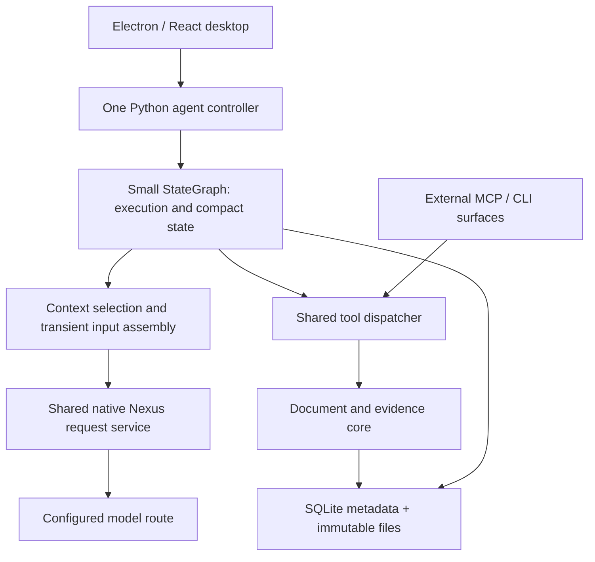

# Integration and model-boundary engineering guide

This guide explains how the independent desktop app, Python agent controller, framework, Nexus connection, and shared tools cooperate. The governing boundaries are in [ARCHITECTURE](../ARCHITECTURE.md), [PRODUCT_REQUIREMENTS](../PRODUCT_REQUIREMENTS.md), and [CONTRACTS](../CONTRACTS.md). The first increment implements a small Python LangGraph `StateGraph`, SQLite metadata and immutable files with pinned dependencies. No measurement established it as the best framework. [CURRENT_STATE](../CURRENT_STATE.md) records verification; the [implemented contracts](../CONTRACTS.md#implemented-first-version-contracts) govern current executable names and choices.

Descriptions marked illustrative preserve the design reasoning and alternatives rather than overriding current APIs, schemas or pins. [Q1–Q3](../OPEN_QUESTIONS.md) records their implementation closure. The detailed [foundation record](../reference/01-foundations-and-frameworks.md) preserves the framework/research discussion and its corrections. Local [discussion sources](../reference/sources/INDEX.md) support optional audit of exact wording. Understanding this guide does not require the original export or old checkout.

<a id="product-and-runtime-boundary"></a>
## 1. The product and its runtime boundary

The user supplies a PDF and a useful scope, and the app's own agent completes the conversion with little manual handling. The intended surface is an independent Electron/TypeScript/React desktop app with a Python backend and configurable model access through Nexus. Independent means that the user does not have to operate Codex or ChatGPT to run the conversion. It does not mean that the model runs offline.

The desktop owns source/scope/configuration entry, progress, saved-document reading, intervention, and export access. The Python controller owns the ongoing agent execution. The model chooses how to inspect, extract, OCR, read pixels, use scripts, reconstruct, and check the document. The app supplies reliable source, document, execution, and context tools. A fixed `inspect → OCR → draft → revise` business pipeline would remove legitimate choices, such as re-OCR of a damaged text layer or going back to an older table header.



The diagram shows responsibility, not required process count. The request service and dispatcher can be modules in the same Python backend. A service name does not require a separately deployed HTTP service. External MCP/CLI access remains useful, but the internal controller does not have to call its own tools through MCP. All surfaces need the same underlying candidate-retention, validation, version, and receipt behavior.

The earlier headless core and an external assistant using it demonstrated bounded tool and content behavior. They did not establish an installable application. Desktop lifecycle integration and usable Windows delivery remain real implementation work. Wider recorded targets are macOS Apple Silicon and Debian x86_64. Intel Mac, CUDA, and Apple Vision were outside the recorded target.

These targets retain the product intention without creating a full platform/provider matrix prerequisite.

**Source basis:** EVT-0001, EVT-0053, EVT-0318, EVT-0382, EVT-0968, EVT-1005, EVT-1166, SUP-01. See [P1-001–002](../reference/01-foundations-and-frameworks.md#p1-001) and [P1-082–083](../reference/01-foundations-and-frameworks.md#p1-082).

<a id="nexus-subscription-and-portability"></a>
## 2. Nexus subscription access and the portability premise

The route corrected during the discussion was:

```text
app → Nexus → CLIProxyAPI → monthly subscription account → selected model
```

The user used Nexus as a subscription connector. Broadening the discussion to Nexus's other metered providers did not answer whether that route supported a feature. Conversely, using an OpenAI-shaped API client does not force use of OpenAI's official pay-as-you-go service. Client library, endpoint, protocol, credentials, actual upstream route, and billing arrangement are different choices.

The user may choose DeepSeek, GLM, Qwen, or another model for cost reasons. The portable baseline therefore assumes provider-native compaction, background result retrieval, and remote cancellation are unavailable. App-owned history organization uses ordinary model requests through the shared service. Discovering an implementation of one native feature on one route does not turn that feature into a requirement of every route.

The historical CLIProxyAPI inspection is useful because it corrected an overly broad claim of no support. It reported local metadata `v8.0.29+dirty` based on commit `5fc580b`, with these bounded findings:

| Inspected behavior | What it established | What it did not establish |
| --- | --- | --- |
| Codex executor exposed standalone `POST /v1/responses/compact` | A code path for explicit compaction existed in the inspected source | End-to-end usability through the user's Nexus route or applicability to other models |
| Translator removed `context_management` | Ordinary automatic compaction configuration did not pass through that inspected path | Absence of every possible compaction route |
| The inspection found no standard `GET /v1/responses/{id}` or HTTP `/responses/{id}/cancel` route | The inspected routes lacked those standard HTTP operations | A universal current feature inventory for all builds or gateways |
| `GET /v1/responses` was a WebSocket entry. An active Codex session could forward `response.interrupt` | A session-specific interruption mechanism existed | General remote cancellation, retrieval of an original unknown result, or a billing guarantee after disconnect |

A public base commit cannot fully identify a dirty build. The inspection did not send generation or compaction requests. These are historical source/metadata observations, not a pinned CLIProxyAPI dependency or new verification of Nexus. The baseline deliberately remains valid without these native services.

A configurable `base_url`, a model alias, or an “OpenAI-compatible” label only identifies part of a connection. These labels alone cannot establish tool-call round trips, vision support, native reasoning preservation, or effective input limits. They also cannot establish upstream identity/tier, cache behavior, or recoverable generation state. The earlier `pi-cliproxyapi-provider` example also used a particular model catalog and `/backend-api/` paths. The discussion did not show that Nexus exposed those same interfaces.

**Source basis:** EVT-0098–0137, EVT-0318, EVT-0349, EVT-0382, EVT-1166. Detailed route correction: [P1-013–017](../reference/01-foundations-and-frameworks.md#p1-013), framework-route fit: [P1-047](../reference/01-foundations-and-frameworks.md#p1-047).

<a id="framework-choice-and-history"></a>
## 3. Why the preferred framework direction changed

The choice concerns how much general execution machinery to reuse while keeping the PDF-specific contracts explicit. A mature framework may reduce maintenance of loops, state, sessions, checkpoints, and recovery. It still cannot decide whether a six-column table is faithful, whether an old header remains relevant, or whether the model actually read a figure label. Equally, a three-line conceptual model/tool loop leaves those execution and domain obligations somewhere in the application. Short pseudocode is not evidence of a small reliable implementation.

The discussion changed direction rather than establishing a stable winner at its first recommendation:

| Stage | Recommendation at that stage | Retained reason and later correction |
| --- | --- | --- |
| EVT-0249 | Extend the existing Python controller with an app-owned context manager, initially using JSON/files | Separate originals from active input. The user then made long-term reliability and remaining maintenance central. Existing code alone did not justify a growing custom runtime. |
| EVT-0256 / EVT-0265 | Evaluate higher-level Deep Agents or LangChain `create_agent`, with direct LangGraph if needed | Reuse mature mechanisms where they fit. The ranking was provisional and did not establish native-route compatibility. |
| ATT-03 / EVT-0318 | API client plus StateGraph plus domain code | Clear transport/execution/domain boundaries were useful. Dismissing Pi as external-CLI-only and conflating a client with Agents SDK were incorrect. The review rejected fixed stages and coarse cleanup rules. |
| EVT-0349 | Pi first, Deep Agents second, direct LangGraph third | Pi's original-session/active-input separation looked attractive. EVT-0360 withdrew the “least modification” ranking because competing frameworks also supported request projections and preserved originals. |
| Middle discussion | Selective `create_agent` plus persistent LangGraph checkpoints | The discussion explored useful middleware responsibilities, including input hydration and tool-result settlement. Hook placement alone did not settle native encoding, batch ordering, candidate capture, or recovery. |
| EVT-0968 / EVT-1068 / EVT-1107 / EVT-1166 | Prefer a small Python StateGraph with shared native Nexus service, shared dispatcher, and document/evidence core | Direct control of complete batches, request assembly, and recovery fit the retained boundaries. Only the three executable contracts remain to be specified. |

The separately recovered [first external response](../reference/01-foundations-and-frameworks.md#supplemental-first-response) proposed a Node controller and PoC cases. Later decisions superseded that controller proposal. Its PoC cases are historical suggestions, not current obligations.

The framework candidates operated at different layers:

| Candidate | Useful capability discussed | Remaining integration work and limits |
| --- | --- | --- |
| Pi | An embeddable Node.js/Bun SDK provides richer sessions, compaction, `context_edit`, and `session_before_compact`. Lower-level loop hooks include `transformContext`/`convertToLlm`. | A TypeScript runtime can cooperate with Python PDF workers, but lifecycle, IPC, state, and upgrades still cost work. Historical Pi 1.3.0 image resizing and truncated summary serialization needed review through supported settings/extensions. |
| LangChain `create_agent` | Maintained agent loop, middleware, tools, and structured-output behavior over LangGraph | Full native message conversion, accepted-reply identity, complete tool-batch control, and domain storage still need integration. It is not only a static chain. A `BaseChatModel` wrapper is optional under the final direct-graph approach. |
| Deep Agents | Filesystem access, large-output offloading, history summaries, optional agent-driven compaction, and customizable backends/middleware | Historical 0.7.29 already handled inline media. The “text-only” description was inaccurate. Size/age defaults need to respect dependencies and useful drafts. One offload-failure branch was not proof of permanent loss without examining original state and independent storage. |
| LangGraph | State transitions, persistence, resume primitives, and small graph construction | LangGraph does not itself compact context, select evidence, join SQLite and file effects atomically, or undo external effects on rollback. Use supported lifecycle behavior rather than build a competing scheduler. |
| LangMem | Running-summary and summarization components | LangMem is not a complete document runtime. Historical handling of overlarge inputs could retain only a final portion. That case needs explicit coverage and segmentation before it can support a complete handoff. |
| OpenAI Python API client | Typed/configurable access to native request families | API access alone is not an agent/context system. `model_extra` and disabling SDK retries solve different problems. The exact client/version is not selected here. |
| OpenAI Agents SDK / Claude Agent SDK and other runtimes | Agent runners, tools, sessions, or product-specific runtime support | Authentication, provider fit, subscription routing, native items, and relevant context behavior still need assessment. Some memory examples rely on provider-side compaction unavailable to this baseline. The review established no complete comparative result. |
| Fully custom controller | Direct control over every responsibility | The application retains maintenance of the entire loop/session/recovery/context mechanism. Control is a benefit with continuing work, not automatically greater reliability. |

An extension and a middleware can contain the same substantial domain logic. Compare equivalent requirements, public customization, lifecycle integration, and maintenance. Do not treat one candidate's customization as a benefit and another's as a disqualification. `ChatOpenAI`'s historical treatment of third-party reasoning fields was a specific compatibility concern. It did not prove that every LangChain integration breaks images or Responses.

Deep Agents does not require one immutable wrapper/SDK stack. The discussion did not prove any framework end-to-end on the rebuild's Nexus route.

<a id="framework-state-projection"></a>
### Preserved state, effective messages, and why the comparison changed

The historical framework terms describe different points in the request lifecycle. Pi's lower-level `transformContext` can transform the agent context before `convertToLlm` converts application messages to model messages. The richer Pi SDK additionally supplies session history and compaction. Adopting the lower-level loop alone does not acquire all of that session behavior.

In the reviewed Pi design, a `context_edit` records an edit that changes later model-visible content while the original session entry remains available. `session_before_compact` is an extension point to cancel, adjust, or supply a compaction result. These operations do not silently rewrite the original event or establish that the model read everything stored in its session.

The correction at EVT-0360 identified the same important separation in Deep Agents 0.7.29. `_summarization_event` records the summary boundary/material, and `_get_effective_messages()` uses it to construct the messages supplied to the model. The ordinary original message state can remain alongside that summary.

Conceptually, preserved messages A–F and a summary covering A–D can yield a request containing the summary plus E–F. A subsequent precise read can supply an original result from A–D again. This is an explanatory sequence, not the exact private event schema. The two underscored names are historical implementation evidence, **not supported extension APIs selected for this app**.

That mechanism invalidated the earlier claim that Pi uniquely supplied preserved originals plus a shorter working view. It did not establish durable storage merely from the presence of original state. The checkpointer/backend and independent evidence files still matter. It also did not prove summary completeness or show that size/age eviction preserves a needed header. Offloading one image does not itself make that image visible to the next request.

File offloading preserves a body outside the window. Active-context release changes future input. Semantic summarization creates continuation content. Each can succeed or fail separately.

LangChain middleware can likewise alter the messages for one model invocation without necessarily mutating all stored graph messages. A comparative assessment must identify stored content, projected content, the supported hook that changes them, and the content that survives restart. Comparing Pi's configured extension with Deep Agents' unmodified default was not an equal comparison. The final preference for a small Python `StateGraph` is a later bounded integration choice. This correction does not reopen framework ranking.

<a id="summary-and-checkpoint-components"></a>
### Summary components and checkpoint components solve different problems

`SummarizationMiddleware` was the historical LangChain component for a configured summary trigger and recent-message retention. LangMem's `summarize_messages` and `SummarizationNode` offered summary generation and a running-summary pattern that incorporates earlier summary state with new material. These can use ordinary model calls. They do not require an upstream `/responses/compact` capability. A running summary is useful continuation data, but repeatedly condensing it can omit earlier detail. The application's required coverage and exact source references do not follow automatically from a component name.

The reviewed LangMem behavior could limit an overlarge summarization input to its final portion under `max_tokens`. If the application claims that the summary covers the entire older interval, silently sending only its tail breaks that claim. The integration must identify what was actually supplied, preserve what was not supplied, and use suitable segmentation or a different fitting request. Similarly, a middleware's extra model call and its own transient retry behavior consume real attempts, time and usage. They must use the shared service/budget boundary rather than create an independent recovery loop.

`InMemorySaver` keeps graph checkpoints in RAM. It can resume within a living process but is not restart storage. A SQLite-backed checkpointer such as the historically proposed `SqliteSaver` supplies persistent graph checkpoint records. Persistence still depends on the selected version and durability behavior. It does not combine a graph checkpoint with document files in one transaction.

Neither saver compacts input or certifies the meaning of a summary. The names here identify the compared components, not installed dependencies or a selected import statement.

`MessagesState` also does not mean “append-only transcript.” Its `add_messages` reducer can replace a message with an existing message ID. Updating message `m1` while it remains in state can replace it. Replaying `m1` after context removal can instead add it to the now-current list. Message IDs therefore help state updates but do not replace the accepted-batch and operation receipts needed to prevent repeated local effects.

The graph checkpoints an `AgentState.active_messages` field if its schema includes that field, even when its comment says “ephemeral.” Putting hydrated base64 images there can repeatedly serialize large bodies. Persist compact references. Hydrate the selected request at the actual request boundary, as explained in [transient hydration](CONTEXT_AND_EVIDENCE.md#transient-hydration).

**Mechanism sources:** EVT-0146, EVT-0249, EVT-0256, EVT-0265, EVT-0297, EVT-0318, EVT-0349, EVT-0360, ATT-03, ATT-04. These explain the historical component behavior and corrections, they do not freshly verify current releases.

A graph can represent `prepare → model decision → chosen tools → continuation` while leaving conversion choices to the model. The forum's “open loop/closed loop” language used the control-theory terms in reverse. The useful issue was fixed workflow versus autonomous task decisions. ReAct describes an action pattern rather than supplying the entire surrounding runtime.

Forum anecdotes, download counts, code length, self-improvement research, and unrelated benchmark gains do not establish a PDF-specific winner. They also do not authorize multi-agent, container, or automatic optimization infrastructure.

**Source basis:** EVT-0138–0146, EVT-0250–0268, EVT-0297, EVT-0318–0360, EVT-0382, EVT-0414, EVT-0968, EVT-1166, ATT-01–06, ATT-20, ATT-23–26. Detailed framework reasoning: [P1-035–050](../reference/01-foundations-and-frameworks.md#p1-035), research claims and confidence: [P1-051–067](../reference/01-foundations-and-frameworks.md#p1-051).

<a id="shared-responsibilities"></a>
## 4. Cooperating components and one owner for each decision

The controller manages the finite execution of an autonomous task. The small graph represents model/tool/context/recovery transitions and keeps compact orchestration state. The context component chooses and assembles the current working input under agent relevance decisions and app capacity constraints. The Nexus service encodes and sends that selection, records attempts and complete accepted replies, and shares durable limits and cancellation with compaction. The dispatcher accepts executable tool batches, preserves received arguments, validates, invokes the appropriate core function, and records results. The document/evidence core owns originals, candidates, immutable versions, precise reads, edits, and explicit-version outputs.

These responsibilities can cooperate without each maintaining its own active context or retry loop. One context decision authority does not require all code to live in one hook. A graph checkpoint is the execution state that the framework resumes. A context handoff changes what the next request contains. Neither one replaces domain operation receipts. SQLite metadata and external files also have different commit boundaries even if one Python process owns both.

The graph may call the native Nexus service directly. It need not wrap that service in a full `BaseChatModel` merely to fit an earlier `create_agent` proposal. If framework message classes are useful, their adapter must preserve actual meaning and the full response association. Their names do not prove which fields survive, where hydration persists, or whether a tool is executable.

A small context-policy projection remains in graph state: selection, pin/release choices, notes, compaction boundary and settled-batch identity. One context coordinator commits disposition and active-policy effects in the existing catalog; graph recovery consumes those records instead of deciding again. The request assembler hydrates large input bodies transiently. Service-owned budgets, versions and receipts also remain durable outside graph rollback. The [context guide](CONTEXT_AND_EVIDENCE.md#compact-policy-authority) distinguishes this current authority from the earlier graph-only simplification, and the [execution guide](EXECUTION_AND_DELIVERY.md#ownership-and-entry-points) defines the recovery boundary.

**Source basis:** EVT-0318, EVT-0414, EVT-0872, EVT-0878, EVT-0968, EVT-1005, EVT-1068, EVT-1166.

<a id="route-profile-and-model-switching"></a>
## 5. Route configuration and model capability semantics

Configuration describes the route the app will actually use, not an imagined capability set inferred from its display name. The following is an illustrative configuration vocabulary, not an agreed schema or automatic probing requirement:

| Configuration fact | Why it matters |
| --- | --- |
| Endpoint/route identity, authentication reference, selected model alias, native protocol | Reconstruct which connection a request used without copying secret values into ordinary journals or documentation |
| Effective input capacity and output reserve | Decide whether the fully assembled input fits. A local estimate and an upstream nominal limit are different facts. |
| Counting method, confidence, and applicable calibration | Treat unknown image/native overhead conservatively rather than as zero. Calibration applies to its actual route and composition. |
| Native image/tool support and representation constraints | A request may be accepted while a required visual or tool capability is absent |
| Reasoning/item format and continuation rules | Preserve applicable provider-native items without pretending unlike opaque/text fields are interchangeable |
| Supported generation parameters and streaming/completion behavior | Freeze actual request settings and decide whether an attempt produced a complete acceptable reply |
| Observable usage/cache categories and known pricing basis | Separate context occupancy, cached input, whole-task benchmark cost, subscription allowance, and unknown actual fees |
| Eligible recovery policy and persistent task limits | Avoid app/SDK/proxy retry multiplication and prevent a model switch or new step from resetting task budgets |

The discussion selected no universal numeric capacity, output reserve, compaction percentage, or retry count. Configuration can represent provider-native result lookup/cancel/compact capabilities if later evidence establishes them. These capabilities are not prerequisites for basic operation. Safe diagnostics identify the route, request, settings, and error without exposing credential values. The rebuild must not recover credentials from old chats or authentication logs.

Switching models is a transfer of work with capability checks. Preserve effective requirements, prepared work, exact references, and unresolved modality needs. Validate a fitting target request before activating the new route. Do not blindly replay one provider's opaque reasoning through another provider. Do not copy old counting/calibration assumptions as though they applied unchanged.

For example, a table may have extracted text but an unresolved superscript or legend visible only in its source image. Switching to a text-only model and deleting the image can make the request syntactically valid while leaving the task unresolved. Useful text or script work may continue. Unsupported visual work must remain explicit or use an available vision route. OCR is not universally equivalent to the pixels. Conversely, a font name alone does not justify a compulsory visual gate on every page.

The optional `query_visual_evidence` design let a text-focused agent ask a configured vision route about exact crops, whole pages, or related pages. Its question, images, route, response, and uncertainty would be derived evidence. The original pixels remain the source. The discussion did not select a mandatory workflow or authorize a model call. Exact model-switch and capability field names remain implementation details within the existing contracts.

**Source basis:** EVT-0137, EVT-0249, EVT-0349, EVT-0534, EVT-0560, EVT-0595, EVT-0638, EVT-1166. See [P1-031](../reference/01-foundations-and-frameworks.md#p1-031), [P2-109–110](../reference/02-context-state-and-evidence.md#p2-109), and [complete-request accounting](CONTEXT_AND_EVIDENCE.md#capacity-accounting).

<a id="historical-private-configuration"></a>
### Historical local configuration and credential delivery

The old development setup used ignored `private/provider.json` for endpoint, protocol, model, `api_key_env` and runtime settings. It stored no key in that JSON. An optional ignored `private/api-key.txt` contained one plaintext credential, without quotes, a `KEY=` prefix or extra lines. Git exclusion did not encrypt the file.

The old runtime used the full endpoint URL and did not infer a route suffix. Responses used `protocol: "responses"` with the full `/v1/responses` URL. Authentication used Bearer credentials from the named process variable. The old route required HTTPS except for loopback HTTP.

The old PowerShell launcher, `tools/run-local-agent.ps1`, read the key without displaying it. It supplied the key through the child-only `ProcessStartInfo.Environment` entry named by `api_key_env`. It used `ArgumentList` for process arguments and left parent, user and machine environment variables unchanged. The key itself never belonged in command arguments, prompts, screenshots or logs.

The app also accepted the configured process environment variable directly, illustrated by `PDF_MD_API_KEY`. For the recorded route, that variable held the Nexus credential. Interactive `--ask-key` read a hidden value into process memory without writing a credential file. The app did not automatically load dotenv files or credential files.

These historical names are examples. This repository does not yet supply that launcher, credential storage or a final configuration schema. Missing local files were errors, not permission to search arbitrary folders or chats. Local file checks did not establish valid credentials, endpoint connectivity, model access or permission for live calls.

**Historical source:** [SUP-05](../reference/sources/support/SUP-05.txt), old `TOOLS.md` lines 75–80, 117–119 and 137–141. The rebuild retains the credential-exclusion and safe-diagnostic requirements stated above.

<a id="historical-provider-configuration-guards"></a>
### Historical endpoint and parameter guards

The old `ProviderConfig.validate_connection()` parsed the full endpoint with `urlsplit`. It rejected a missing hostname, nonempty username/password values and nonempty fragments. It required HTTPS except for HTTP with the exact parsed hostname `localhost`, `127.0.0.1` or `::1`. This was a specific loopback exception, not permission for arbitrary plaintext HTTP.

The connection check rejected these exact keys inside `parameters`: `model`, `messages`, `input`, `tools`, `stream`, `store` and `instructions`. Those fields belonged to the controller's request construction. Other parameter names still depended on the selected route's support. Passing the local check did not establish upstream compatibility or authorize a model call.

These guards describe the old implementation. They do not select the rebuild's final configuration schema. [SUP-23](../reference/sources/support/SUP-23.txt) preserves the relevant `provider.py` checks.

<a id="native-protocol-and-adapter"></a>
## 6. Native request/response meaning and the adapter boundary

Keep these three objects distinct:

- The immutable native journal of received messages/items.
- The selected working input.
- Its encoded wire request.

The adapter encodes the selection. It does not independently decide to reread all historical files or restore released images. It may load or stream the already selected bytes from disk. A categorical ban on adapter disk access would add no useful protection. Obeying the frozen selection is the boundary that matters.

Preparation resolves source/version/range/image references and freezes route settings, generation parameters, tool schema identities, and actual selected content for one logical request. A file path that resolves to different content later is not a frozen input. A manifest or digest can validate retained bytes but cannot recreate missing bytes. The app can reconstruct what it assembled at this boundary. That reconstruction does not prove that Nexus made no later transformation or reveal what a model internally understood. See [input-view and causal linkage](CONTEXT_AND_EVIDENCE.md#input-view-and-causality).

The two protocol families require native treatment:

| Item | Chat Completions discussion | Responses discussion | Common application obligation |
| --- | --- | --- | --- |
| Tool invocation | Assistant tool calls with their native call IDs and arguments | Native function-call items and call identities | Preserve the complete original invocation and associate it with its actual accepted parent reply |
| Tool result | Paired tool messages for the accepted calls | Corresponding function outputs, illustrated by `function_call_output` and `call_id` | Complete the accepted batch's results before preparing the next model judgment |
| Image evidence | Native image content. The retained old sequence completed tool results before appending that batch's paired native-image user message. | The adapter encodes selected images using the applicable native image form, illustrated by `input_image`. | Send actual image input with correct source/result association. A path or base64 text alone is not proof of vision input. |
| Reasoning or extra native items | A route may return third-party fields such as `reasoning_content` | A route may return structured, encrypted, or opaque items with continuation requirements | Preserve received types/provenance. Apply the actual route's replay rules. Do not flatten everything into ordinary prose. |
| Streaming response | Complete the attempt's native response and applicable finish/error handling | Complete the attempt's response/item lifecycle | HTTP 200 or a partial JSON fragment alone does not establish a complete executable reply |

The names in this table preserve the discussed protocol examples, not a final versioned schema. Ordinary textual explanation, structured reasoning items, encrypted items, and provider-specific fields are not interchangeable. The application can preserve only what the service returned. It cannot promise recovery of private reasoning that the service never delivered. A universal `TurnReasoning` class that loses these distinctions would make the abstraction misleading.

<a id="native-payload-examples"></a>
### Concrete payload distinctions from the early driver proposal

ATT-03 called the proposed transport boundary `ModelTransport`, with `ResponsesDriver` and `ChatCompletionsDriver`. Its `TurnInput`, `TurnOutput`, `ToolCall`, `ImageBlock`, `TurnReasoning`, and `ProtocolAdapter` were illustrative application types. The proposal intended them to isolate wire differences, not to define one flattened lowest-common-denominator message format. The final design retains the native adapter responsibility without selecting those class names or requiring separate driver packages.

For example, the discussed image content fragments differ even when the selected image bytes are the same:

```json
{"type":"input_image","image_url":"data:image/png;base64,<selected image bytes>"}
```

```json
{"type":"image_url","image_url":{"url":"data:image/png;base64,<selected image bytes>"}}
```

The first illustrates Responses content. The second illustrates Chat Completions content. They are fragments, not complete valid requests. The adapter still places them in a valid message/item sequence, preserves provenance, and accounts for actual image input. Substituting the literal placeholder, a file path, or base64 text in an ordinary text block would not deliver those pixels as an image.

The Responses tool-result example uses `type: "function_call_output"` with `call_id` and `output`. The Chat example uses a message with `role: "tool"`, `tool_call_id`, and `content`. The ID binds a result to a particular accepted call. If one accepted reply contains two calls, returning only the first result and requesting another model decision leaves the batch incomplete.

Complete the batch, including explicit rejected-call results where appropriate. Then construct that protocol's next request. The old Chat image path paired the batch's native-image user message after its formal tool results. An adapter must preserve that relationship rather than flush an unrelated global image queue.

The ordinary OpenAI Python client examples were `AsyncOpenAI(base_url=..., api_key=..., max_retries=0)`, `client.responses`, and `client.chat.completions`. `base_url` chooses a connection such as Nexus. `max_retries=0` disables that client's retry layer. Neither enables native compaction or agent persistence.

In the discussed Chat response, `message.model_extra.get("reasoning_content")` accessed an additional returned field. Responses could instead carry native reasoning items in `output`. Keeping both originals does not justify converting them to interchangeable text or replaying opaque items to another provider. These details distinguish “API client,” “agent runner,” and “native response adapter”.

**Payload sources:** ATT-03 and the corrections in EVT-0318, final responsibilities in EVT-1166. These are historical examples, not current external API verification or a final application schema.

<a id="historical-outbound-reasoning-and-usage"></a>
### Historical outbound reasoning and usage settings

The old Responses encoder always set `store=False`. If `include` was absent, it defaulted to `["reasoning.encrypted_content"]`. A caller-supplied `include` value remained unchanged. The purpose was to request replayable encrypted reasoning for stateless continuation. The adapter still needed to preserve returned native items and follow the actual route's continuation rules.

The [official Responses guide](https://developers.openai.com/api/docs/guides/reasoning) checked on 2026-10-23 says stateless reasoning returns encrypted content by default. That documented API accepts the legacy `include` setting without requiring it. The historical setting is therefore not a universal prerequisite. Neither the old default nor current official documentation verifies a particular Nexus route.

For streaming Chat Completions, the old encoder merged `stream_options` and forced `include_usage=True`. That option requests a final aggregate usage chunk. An interruption can prevent its arrival even with the option enabled. Missing usage remains unknown and does not imply zero charges. The [official Chat streaming reference](https://developers.openai.com/api/reference/resources/chat/subresources/completions/streaming-events) describes this limitation.

**Historical sources:** [SUP-08](../reference/sources/support/SUP-08.txt), old `TECHNICAL_STACK.md` lines 64–70. [SUP-11](../reference/sources/support/SUP-11.txt) preserves the request encoder at `provider.py` lines 248–269. These are request settings, not guarantees of server storage, complete reasoning or reported usage.

<a id="historical-usage-normalization"></a>
### Historical usage normalization and observed details

The old `usage(response)` helper normalized the two native naming families as follows:

| Normalized field | Historical lookup |
| --- | --- |
| `input_tokens` | `usage.input_tokens`, falling back to `prompt_tokens` only when the primary key was absent. |
| `output_tokens` | `usage.output_tokens`, falling back to `completion_tokens` only when the primary key was absent. |
| `total_tokens`, `cost` | Copy the corresponding reported value without deriving a total or a price. |
| `cached_input_tokens` | Read `cached_tokens` from the first nonempty `input_tokens_details` or `prompt_tokens_details` object. |
| `reasoning_tokens` | Read `reasoning_tokens` from the first nonempty `output_tokens_details` or `completion_tokens_details` object. |
| `raw` | Retain the supplied usage object separately from the normalized fields. |

An explicit null primary token value did not trigger the prompt/completion fallback. The detail lookup did not merge objects or search the second object when a nonempty first object lacked the requested field. Missing fields remained unknown. The helper did not establish actual billing or make reasoning tokens an additional charge beyond an already inclusive output count.

Failed-attempt `observed_usage` used a separate numeric filter. It accepted finite, nonnegative integers or floats and excluded booleans. Its exact allowed keys were:

- `input_tokens`, `output_tokens`, `total_tokens`, `prompt_tokens`, `completion_tokens`, `cost`.
- `cached_tokens`, `reasoning_tokens`, `cache_write_tokens`, `audio_tokens`, `accepted_prediction_tokens`, `rejected_prediction_tokens`, `text_tokens`, `image_tokens`.

The filter recursively retained those numeric fields inside `input_tokens_details`, `output_tokens_details`, `prompt_tokens_details` and `completion_tokens_details`. Unknown fields and nonnumeric values did not enter that diagnostic record. This filtered observation was distinct from the normalizer's `raw` usage object and from withheld provider error bodies.

[SUP-23](../reference/sources/support/SUP-23.txt) preserves both historical functions. Their field names explain the old accounting path, not a finalized rebuild schema or complete provider usage catalog.

Receive and retain native data before framework decoding can discard useful content. Then distinguish complete accepted response, executable tool call, rejected arguments, and incomplete received content. The framework may represent malformed JSON as `invalid_tool_calls` or omit it from ordinary ToolNode dispatch. Thus, that content may never reach tool middleware. The common pre-validation entry must preserve successfully decoded but schema/domain-invalid arguments before rejection.

Retention preserves useful work and diagnosis. It does not permit execution of partial JSON or joining separate attempts. Exact candidate semantics belong to the [document guide](DOCUMENT_ENGINE.md#candidate-capture). Provider-error filtering follows the [diagnostic boundary](#provider-diagnostics-and-preservation) below.

The adapter also preserves the response-to-request relationship. A historical LangChain integration proposed a namespaced application entry in `response_metadata`, while keeping provider metadata and the full `ModelResponse`. `additional_kwargs` can contain provider encoding data and is not a freely interchangeable slot. Middleware may invoke a handler more than once or return multiple messages. Thus, associating a tool with “the most recent input view” globally is unsafe. The accepted reply must carry its own actual input identity.

Image queues left by earlier requests are a particular integration risk. The old provider held pending images until a later flush. Extracting its HTTP function alone would not extract the pairing lifecycle. A reusable model object may retain configuration, connection pools, and service references. A second request or task must not inherit another request's unresolved image batch. Literal mathematical statelessness is not required.

Historical `model_extra` preservation and `max_retries=0` were separate features: the former concerned extra returned fields, while the latter disabled the SDK's independent retry owner. Neither establishes that a higher-level wrapper retains every item or inherits the old controller's durable limits. The [execution guide](EXECUTION_AND_DELIVERY.md#request-and-attempt-identity) owns accepted-reply reuse, attempt identity, unknown outcomes, and finite replay.

**Source basis:** EVT-0249, EVT-0318, EVT-0730, EVT-0826, EVT-0914, EVT-0942, EVT-0968, EVT-1005, EVT-1166, ATT-03, ATT-17, ATT-20, ATT-23–26. See [P1-030](../reference/01-foundations-and-frameworks.md#p1-030), [P1-069](../reference/01-foundations-and-frameworks.md#p1-069), and [adapter integration history](../reference/03-documents-delivery-and-recovery.md#adapter-integration-boundaries).

<a id="tool-discovery-and-dispatch"></a>
## 7. Tool discovery, shared dispatch, and capture

The agent needs enough tool guidance to choose legitimate source and document operations. Discoverable descriptions, schemas, available representations, scope, sizes, pointers, omissions, and warnings make that choice possible. A friendly shape/representation catalog can remove the need to guess a JSON Pointer. It does not justify an always-minimal first reply or prove why an earlier agent chose a full inspect. Full/raw/field/range/image access remains available from the first call within actual capacity.

The dispatcher is the common execution boundary for the built-in controller and external tool surfaces. It can expose a direct catalog/schema description to the controller and let an MCP/CLI adapter expose the same underlying contracts. The discussion selected no extra tool-search service, fixed catalog size, or exact discovery API. Calling a function internally does not require a loopback MCP transport. Discovery communicates capability. The accepted response and dispatcher determine which calls can actually execute.

The required capture order must be wired at each entry:

```text
native model response received → preserve actual native content
app-received successfully decoded tool request → preserve original arguments
schema/domain validation → execute eligible operation → original receipt
```

This is a logical sequence with two distinct retention boundaries. The Nexus receiving layer can retain response content before tool parsing. The common tool entry preserves successfully decoded arguments before domain validation. A wrapper inside an already validated registered function is too late to protect rejected parameters.

The historical inspection found `Extension.intercept_tool_call` in installed MCP SDK 2.3.0, before registered-tool validation for an accepted `tools/call` request. That was a possible supported entry for preservation without weakening useful schemas. Before implementation, verify the exact hook for the selected version. This repository does not pin or implement it.

Permissive container schemas cannot guarantee arrival. Malformed envelopes or wrong types can cause earlier rejection, and an external client can reject content first. The server can preserve what reaches it, not content withheld by another client or bytes never received.

Tools can report references and context-change intents, but their mere presence in an internal `artifact` object does not send them to the model. The assembler deliberately constructs visible text/images. Likewise a compact historical account is ordinary reference data, not a new pending native call. Executing a shortened display of old JSON would confuse context projection with operation replay.

The controller that owns the complete accepted batch also owns necessary sequencing. A small sequential tool node is legitimate. Independent reads may run in parallel where their resource/effect contract permits. OCR and rendering can create files or subprocesses, so calling them “reads” does not make every instance free of effects. Do not add a second hidden scheduler to preserve the surface form of `create_agent`.

A document transaction is short. Model inference, OCR, and an entire turn should not sit inside one document lock. Detailed ordering and replay live in [accepted-batch execution](EXECUTION_AND_DELIVERY.md#accepted-batch-execution).

**Source basis:** EVT-0001, EVT-0249, EVT-0382, EVT-0414, EVT-0914, EVT-0942, EVT-0968, EVT-1005, EVT-1166, ATT-06, ATT-23–26. See [P1-005](../reference/01-foundations-and-frameworks.md#p1-005), [P1-086–088](../reference/01-foundations-and-frameworks.md#p1-086), and [cross-interface capture](../reference/03-documents-delivery-and-recovery.md#cross-interface-capture).

<a id="source-access-and-fidelity"></a>
## 8. Source access and fidelity cross every integration layer

A successful API call must still deliver the representation the agent requested. The core preserves complete results actually computed and their source/page/region/operation identity. An immutable evidence object can be presented in full, by fields/ranges, or as a reference without changing its original. Re-reading an exact prior OCR result is different from running OCR again. Preserving a result does not require computing words, characters, images, or renders that were never requested.

Image preservation and image presentation are separate checks. Native extraction retains dimensions and encoding when faithful. An existing JPEG is valid. Vector, composite, or scanned material may require a faithful lossless crop/render with provenance. Do not silently resize, whiten, redraw, reduce color/bit depth, or introduce lossy recompression.

A native file on disk is insufficient if the adapter only sends its pathname. Conversely, a document-preview screenshot is not the source image exported with the document.

The model may need older evidence despite current page focus. A table continuing onto page 19 may still depend on page 18's header, units, and notes after page 18 was saved. `active_pages`, recency, successful save, font warnings, and OCR confidence do not decide semantic necessity. Text/layout/words/chars and local style/opacity can each matter. Extractor block/line order is not certified natural reading order, and an absence of warnings is not proof of a correct page.

Compact views may reduce duplicate representations or factor shared styles while retaining location-specific meaning, discoverable full detail, and explicit omissions. The historical 191,662-character result already contained block/line/span layout. Removing its approximately 39,324 word-data characters left 147,366 layout characters. That observation did not establish a sufficient universal field preset, a new extractor requirement, or equal-fidelity savings. The core and assembler must distinguish original size, selected presentation, and bytes/tokens actually sent.

If a requested result fits alone but not with accumulated history, context organization may make room. If the result itself exceeds usable capacity, preserve it. Explicitly describe its scope, size, location, omitted presentation, and precise read/script options. “Tool execution completed” and “every requested byte reached the model” are different outcomes. Do not silently return a prefix as though complete. Do not rerun an expensive operation merely because presentation failed.

The [context guide](CONTEXT_AND_EVIDENCE.md#oversized-results) owns the capacity transitions.

Trusted task scripts extend the agent's methods without a new product API for every transformation. They are process-opt-in/off by default, run with host-user privileges, and are not an OS sandbox. Once enabled for the task, autonomous own-task use needs no routine per-script approval. Complete files/logs survive bounded return text. Scripts do not erase already consumed history, and source commands or forum instructions remain inert data.

<a id="script-credential-boundary"></a>
### Historical trusted-script execution

For enabled `transform` calls, the old runner used a reduced environment that omitted inherited API credentials. It retained `PDF_MD_TASK` as a document pointer. This environment filtering did not remove host-user permissions or make scripts an OS sandbox. The existing opt-in requirement and source-data boundary still apply. [SUP-05](../reference/sources/support/SUP-05.txt) preserves the old `TOOLS.md` explanation at lines 646–650.

The runner inherited only variables whose names matched `SYSTEMROOT`, `WINDIR`, `TEMP`, `TMP`, `PATH` or `LANG`, ignoring case. It then added `PDF_MD_TASK`. It saved the submitted code as `scripts/<run>/task.py` and used that run directory as the child process's working directory.

The historical command was `[sys.executable, "-I", "-X", "utf8", str(run / "task.py")]`. It used the project's Python interpreter, isolated interpreter mode and UTF-8 mode. These flags did not restrict the script's host filesystem or network permissions.

`timeout` defaulted to 30 seconds and accepted values greater than zero through 300 seconds. The shared runner applied that timeout to waiting for the child after creation. Creation and cleanup used cancellation shielding. Cleanup killed the direct child if it still ran, then waited under a separate five-second limit. The timeout was therefore not a strict end-to-end wall-clock ceiling. The mechanism did not guarantee termination of descendants that a script deliberately created.

The runner saved complete stdout and stderr in separate files. After an ordinary return, each inline field contained its file's first **16,000 bytes**, decoded as UTF-8 with replacement for invalid bytes. This was neither a 16,384-byte limit nor a character count or combined limit. Cancellation or failure could prevent a normal reply, while retained files and status supported inspection. A bounded reply did not replace the original logs.

These are historical mechanics, not rebuild defaults. [SUP-21](../reference/sources/support/SUP-21.txt) preserves `scripts.py`. [SUP-22](../reference/sources/support/SUP-22.txt) preserves the shared process runner. The [execution guide](EXECUTION_AND_DELIVERY.md#process-and-progress) explains inspection, termination and salvage responsibilities.

Fidelity applies to source wording, meaningful glyphs, units, emphasis, reading order, cross-page relationships, table relationships, complete figures/captions, and searchable labels. The product permits reflow. Paraphrase or guessing cannot replace difficult evidence. Physical positions, printed labels, `none`, `unknown`, outside-scope, and unprocessed states remain distinct. The [document guide](DOCUMENT_ENGINE.md) details local edit and render mechanics. Tools and protocol adapters must preserve these distinctions.

**Source basis:** EVT-0001, EVT-0137, EVT-0249, EVT-0318, EVT-0382, EVT-0400, EVT-0414, EVT-1166. See [P1-003–006](../reference/01-foundations-and-frameworks.md#p1-003), [P1-028](../reference/01-foundations-and-frameworks.md#p1-028), [P1-075–076](../reference/01-foundations-and-frameworks.md#p1-075), and [P1-087–088](../reference/01-foundations-and-frameworks.md#p1-087).

<a id="illustrative-integration-sequence"></a>
## 9. An illustrative source-to-delivery sequence

The following sequence joins the boundaries. It is not a compulsory conversion recipe, fixed node schema, or a completed test:

1. The user selects a source and complete section, and chooses a configured Nexus route. The controller records effective requirements. Source text is data. Later user corrections remain effective input.
2. The model chooses useful source operations. The dispatcher preserves accepted arguments and executes the calls through the shared core. Complete evidence and provenance survive even when only a selected view enters the next request.
3. At the safe batch boundary, context preparation resolves relevant evidence and version references. It assembles actual native text/images/tool exchanges and checks the whole request with output reserve. The shared service records the frozen logical request and applicable attempt consumption before sending.
4. The service retains a complete accepted native reply with its request association. Only its executable accepted calls enter dispatch. The service retains a cut-off reply as received material. The runtime neither executes that reply nor joins it to the next attempt.
5. A save candidate contains correct prose but invalid page metadata. Its exact content remains accessible. The agent can reference that candidate and repair the map without generating the prose again. The document core validates the complete merged result and commits according to Q1's defined boundary.
6. As work grows, the agent may release saved unnecessary evidence. If history still needs organization, the controller prepares an identified ordinary model request for a self-sufficient handoff. That request uses the same service, limits, cancellation, and accepted-reply handling. Producing that handoff is a real model call, not a free hidden action inside preparation.
7. The user can inspect the saved version while conversion continues. A reconnecting UI reads durable state and version content. It does not reconstruct the document from streamed tokens or progress notifications.
8. The explicitly selected immutable version supplies Markdown, JSON, safe HTML, images, and ZIP. Saved work can be exported after inference stops. Execution status, the agent's completion claim, scoped source checks, and export consistency stay distinct.

For Chat Completions, the assembler combines the call/result relationship and the batch's image message after all formal results are available. For Responses, the adapter encodes the corresponding native function outputs and image/items under that protocol. In either case the next normal model judgment follows complete batch settlement. Framework conversion must not turn the illustrative common sequence into an invalid native history.

A transport retry of step 3 uses that request's frozen input, even if a later action advanced the current document head. A changed-context correction is a new logical request, subject to the original task limits. The [execution guide](EXECUTION_AND_DELIVERY.md#worked-recovery-sequence) supplies the detailed commit/re-entry example. The [context guide](CONTEXT_AND_EVIDENCE.md#transient-hydration) explains working projections without changing executable originals.

**Source basis:** EVT-0249, EVT-0414, EVT-0914, EVT-0968, EVT-1005, EVT-1068, EVT-1107, EVT-1166.

<a id="desktop-process-boundary"></a>
## 10. Desktop, Python workers, progress, and rendering

The preferred topology keeps one Python control layer rather than both Node and Python running independent agent loops. Electron still has its own process/lifecycle responsibilities. Long agent work should not depend on the UI/main thread performing it. The earlier Node/Pi-led proposal aimed to reduce Python-to-Node OCR nesting and duplicate Chromium resources. The discussion did not require moving all control to TypeScript. The Python baseline superseded that proposal.

Workers may remain alive and cache an open PDF, parsed structures, fonts, or other reusable data. They need not restart for every operation or be mathematically stateless. A worker can write evidence files while one document publication authority registers committed versions and reconciles them. A single authority does not mean every output byte must be written by one process. Language choice alone prevents neither competing task state nor packaging problems, and cached handles do not establish universal millisecond performance.

Asynchronous JSON over standard input/output was the historical desktop connection direction. Exact framing and library choices remain open. Keep protocol messages and diagnostics on deliberately separate channels. Progress can describe preparation, capacity, requests, attempts/backoff, streamed character counts, OCR progress, candidate retention, and committed versions. An OCR page event means evidence extraction completed, not that conversion or source acceptance completed.

Durable state is authoritative. Important result events follow their commit. UI reconnection starts from a snapshot with sequence/revision, and the UI reads versions directly. The runtime can combine high-frequency progress updates. The UI's reading speed should not drive the normal conversion loop.

Finite pipes/queues nevertheless require explicit limits and backpressure/failure behavior. A promise of unlimited non-droppable replies, never-blocking producers, and indefinite receiver failure is impossible with bounded storage. The [execution guide](EXECUTION_AND_DELIVERY.md#process-and-progress) owns these finite failure and child-process details.

Shared rendering between user reading and agent preview can reduce divergent HTML/CSS and duplicate browser resources. The preview still needs an explicit immutable version, asset readiness, fonts, viewport, zoom, and crop/coordinate meaning. Electron `capturePage()` and DOM/CDP targeting were options, not a selected universal screenshot method. Huge blocks, clipping, scrolling, and disjoint regions can require several bounded captures. Sharing Chromium does not promise identical appearance under different conditions or complete content in one screenshot.

Actual reading and expanded diagnostic views remain distinguishable. The [document guide](DOCUMENT_ENGINE.md#rendering-and-preview) owns their semantics.

<a id="capture-and-worker-mechanics"></a>
### What the proposed capture and worker APIs would actually do

The early Electron proposal used a `BrowserWindow` and `webContents.capturePage()` to capture rendered output. The ordinary visible capture does not by itself locate every part of a long table or render a complete off-screen document. ATT-06 therefore suggested locating requested content by `target_block_ids` or mapped `pdf_pages`, then obtaining a DOM rectangle with `getBoundingClientRect()`. It proposed CDP `Page.captureScreenshot` with a `clip` and, where supported, `captureBeyondViewport`.

A correct sequence would perform these steps:

1. Resolve the targets on the requested immutable version.
2. Wait for its fonts and image resources.
3. Locate the actual elements.
4. Translate the bounds into the capture coordinate system with the relevant scroll/zoom/device scale.
5. Capture bounded regions.

A DOM rectangle does not override an overflow container's clipping or guarantee that a huge target fits within capture/resource limits. The capture may need several segments. Separate captures may represent disjoint targets better than a mostly empty rectangle. Report actual extent and conditions with the returned pixels. These were implementation options, not a requirement to build advanced CDP targeting before a useful first flow.

The proposed `fitz.Document` cache referred to a resident PyMuPDF document handle. Reusing it can avoid repeated document opening/parsing and can support repeated page work. It does not eliminate OCR, image decoding, rasterization or model time. PyMuPDF/Pillow workers can remain alive and write immutable evidence files for registration by the authoritative service.

The historical alternative put Tesseract.js workers in Node and considered Electron `utilityProcess` or a Worker for long work. Those are process-placement options, not competing task authorities or an OS sandbox. The final Python-control baseline supersedes the Node-led proposal while preserving the reasoning about independent UI lifecycle, bounded IPC and reusable workers.

**Mechanism sources:** ATT-05, ATT-06, EVT-0382, EVT-0414, final topology in EVT-1166. Packaging sizes, performance promises and a fixed OCR/process configuration were not established.

The installed product must supply its required runtimes. The rebuild does not silently inherit old environment paths, package versions, process counts, or OCR worker choices. Packaging and permissions remain implementation work under the product scope. A useful complete flow need not wait for resolution of every hypothetical isolation or platform scenario.

**Source basis:** EVT-0001, EVT-0382, EVT-0414, EVT-1068, EVT-1107, EVT-1147, EVT-1166, ATT-05, ATT-06, ATT-27–30, SUP-01.

<a id="historical-local-ocr"></a>
### Historical local OCR compatibility and timeout semantics

The old OCR setup selected Tesseract.js `6.0.1` with core `6.1.2` and local `chi_tra`/`eng` `best_int` data. Both language packages used version `1.0.0`. Recognition sent no source, image or text to a recognition service and required no runtime language download.

The recorded `6.0.1`/core `6.1.2` pair initialized both languages separately and together. The `7.0.0`/core `7.0.0` pair emitted misleading multilingual loading diagnostics with the same data, despite cold single-language success. This observation explained the old compatible lock. It did not establish universal v7 failure, OCR accuracy or installed-app readiness.

Before combined recognition, that implementation checked installed language files and cold-initialized each requested language independently. Returned records included package version, uncompressed SHA-256/size and initialization state. A missing language failed without silent English fallback. Any language-load diagnostic prevented a successful recognition claim. Producing text alone therefore did not prove that the requested language data loaded correctly.

The old `ocr` tool's `timeout` argument applied to each page, with a default of 120 seconds and a maximum of 300 seconds. Those values were historical defaults, not an overall batch deadline or rebuild settings. Completed page results survived a later failure or cancellation. Initialization checks belonged inside that OCR implementation, not before every conversion. The agent still chooses whether OCR is useful.

<a id="historical-ocr-settings-and-worker"></a>
#### Page segmentation, confidence and worker lifetime

The old defaults were `languages=["chi_tra","eng"]`, `dpi=300` and `psm=3`. DPI specifies render dots per inch. PSM selects Tesseract's page segmentation mode:

| PSM | Historical interpretation |
| --- | --- |
| `3` | Automatic layout. |
| `6` | One text block. |
| `7` | One text line. |
| `11` | Sparse text. |

The implementation accepted recognition modes 3–11 and 13. Orientation and script detection, or OSD, required data that the old installation did not supply. The tool rejected unsupported modes instead of silently changing them. Each selected page or region used a fresh render and recognition, not the PDF's existing text layer as OCR output.

Whitespace-only recognized text produced an empty-recognition warning. The tool also counted nonempty TSV word candidates with confidence below 80 and reported their count. That threshold applied to individual words, not the overall page confidence. High confidence did not certify wording, numbers, layout or table relationships. Word results retained render-pixel boxes and unrotated PDF-point `bbox_pdf` boxes.

Each page started one local Node process. Tesseract workers used threads within that process. Cold language checks created and terminated separate workers before combined recognition. Killing that Node process stopped its recognition. This did not establish arbitrary descendant-process control, installed desktop behavior or performance beyond the recorded excerpts.

[SUP-19](../reference/sources/support/SUP-19.txt) preserves the Python settings, validation and warning logic. [SUP-20](../reference/sources/support/SUP-20.txt) preserves `ocr/worker.cjs`. The historical thread/process description also appears in SUP-05. These settings remain selectable historical tactics, not mandatory conversion stages or rebuild dependency pins.

**Historical sources:** [SUP-04](../reference/sources/support/SUP-04.txt), old `TECHNICAL_STACK.md` lines 23, 44–46 and 78–84. [SUP-05](../reference/sources/support/SUP-05.txt) preserves old `TOOLS.md` lines 487 and 538–561. These versions are not rebuild dependency pins.

<a id="historical-desktop-packaging"></a>
### Historical packaging direction and its limits

The old desktop plan selected Electron Forge's Webpack + TypeScript template because Forge then marked its Vite integration experimental. It proposed an initial PyInstaller one-folder Python bundle inside Electron, so users would not need a separate Python installation. Its OCR packaging direction included bundled Node and unpacked worker, WASM and language-data resources.

These were packaging directions, not a verified installed application. Electron, React and Forge were inactive in the recorded local environment. The rebuild still requires the installed product to supply its necessary runtimes. Future implementation must select compatible versions and check the resulting package on its target platform. The historical Vite observation does not establish its current status or select a rebuild template.

**Historical source:** [SUP-04](../reference/sources/support/SUP-04.txt), old `TECHNICAL_STACK.md` lines 21, 32–35, 44–46 and 84.

<a id="integration-failure-cases"></a>
## 11. Concrete integration failures and the retained response

These cases explain contract boundaries. They do not claim that the rebuild encountered or solved every case.

| Case | Why a superficial success is insufficient | Required boundary or retained direction |
| --- | --- | --- |
| A model alias accepts text but cannot consume an unresolved figure | HTTP success does not satisfy the remaining visual task | Keep the visual requirement and source reference. Continue supported work or use an available suitable route under task policy. |
| A native image is saved but only its path appears in the request | Storage is not vision input | Deliberately encode the selected image and retain its source/result association |
| A second task inherits a pending image queue | Shared client state can pair unrelated evidence with a new request | Keep request/batch selection isolated while permitting reusable configuration/pools |
| Middleware drops extra reasoning/native items | A common message shape may lose fields required by the actual route | Preserve originals. Verify the adapter's supported projection. Do not infer loss from class names alone. |
| A stream ends mid-tool arguments after HTTP 200 | The response is not a complete executable batch | Preserve received content. Never execute partial JSON or concatenate different attempts. |
| A tool's metadata fails before its function body runs | Preservation inside that function may never execute | Capture at the app receiving/decoded-tool boundary. Then validate. Do not claim retention of bytes that the app never received. |
| A complete accepted reply exists but the graph checkpoint is absent | Blindly calling the model again duplicates an already available judgment | Reconcile by durable logical request identity. Finish its accepted batch. Exact re-entry belongs to Q3. |
| An oversized result is complete on disk | A successful operation does not make the next input fit | State presented/omitted scope and exact read options. Capacity preparation must not silently truncate. |
| A provider rejects a request estimated locally at 80,000 tokens | A rejection can reflect bytes, images, output reserve, route limits, or another error | Record actual diagnosis and estimator separately. Do not redefine the model window from one failed estimate. |
| A save commits before its graph checkpoint | Graph replay does not roll back document effects | Return the original operation receipt without duplicate append or head regression. See the recovery contract. |
| The UI disconnects during OCR | Lost notifications are not proof the child process stopped | Inspect durable task/process state. Distinguish progress transport, termination, and salvage. |
| A wrapper passes old fixture tests | Tests may exercise old modules or a mock that ignores the actual assembled context | Verify changed boundaries and actual authorized source output. Inherited counts are not evidence of a new adapter. |

Generic 500/502, context overflow, HTTP payload size, authentication failure, incomplete response, and user cancellation are not interchangeable errors. Context-specific re-preparation changes the selected input. Eligible transient replay preserves frozen input. The same shared service accounts for ordinary and compaction calls so wrappers cannot multiply retries or bypass cancellation. Broader network features such as circuit breakers, shared traffic controls, background retrieval, and universal remote cancellation remain deferred rather than becoming prerequisites here.

<a id="provider-diagnostics-and-preservation"></a>
### Provider diagnostics and the native-preservation boundary

The old client shared a fixed `error.type`/`error.code` allowlist across HTTP and in-band service errors. It checked decoded labels for credential text before audit or exception exposure. Raw-string replacement alone was insufficient because JSON escapes could conceal credential text until decoding. The filter excluded free-form messages, unknown labels, params, arbitrary headers and URLs. Unrecognized HTTP errors retained a status-only fallback.

The client withheld raw HTTP error bodies, in-band service-error frames, raw SSE heartbeat comments and unparseable, unframed or non-native provider fragments. It kept safe byte counts, SHA-256 hashes and fixed withholding reasons where recorded. Safe status, allowlisted labels, timing and validated `Retry-After` remained separate diagnostic metadata. These records did not prove remote generation, cancellation or settlement.

The client retained complete structurally native HTTP-200 JSON replies and complete framed native model events. These included refused or argument-invalid native replies and complete model frames received before interruption. Preservation did not accept those replies or authorize execution. Complete preceding native frames survived even when their transport chunk also contained an excluded service-error frame. The client redacted known credential literals from retained provider evidence. Source/tool raw records and native-image access remained complete and independent of provider-error filtering.

<a id="historical-machine-error-labels"></a>
#### Machine labels describe different failure boundaries

The old diagnostic names had these distinct meanings:

| Label | Historical origin and limit |
| --- | --- |
| `context_too_large`, `context_length_exceeded` | Allowlisted `error.code` values. The diagnostic called for reducing active input while preserving requested scope, not automatic truncation or a larger model window. |
| `http2_protocol_error` | A fixed `upstream_condition` marker derived from recognized HTTP-error message patterns. It reported an upstream stream condition without copying the message or establishing its deeper cause. |
| `stream_incomplete` | Another fixed HTTP-error `upstream_condition` marker for recognized premature stream closure. It did not establish rejection before generation. |
| `incomplete_stream` | The local stream assembler's separate reason when its input ended without required completion. Its spelling and origin differed from `stream_incomplete`. |
| `request_timeout` | Both an allowlisted proxy error code and the local `ModelTimeoutError.reason`. The record's origin distinguished these uses. Neither proved zero generation or charges. |

Allowlisted labels and derived fixed markers still passed the decoded-credential filter. Their presence did not independently authorize replay. The old controller applied eligibility and the [persistent retry policy](EXECUTION_AND_DELIVERY.md#historical-retry-hierarchy).

SUP-09 preserves the historical diagnostic explanation. [SUP-23](../reference/sources/support/SUP-23.txt) preserves the corresponding local classifications and parser branches.

**Historical sources:** [SUP-08](../reference/sources/support/SUP-08.txt), old `TECHNICAL_STACK.md` line 68. [SUP-09](../reference/sources/support/SUP-09.txt) preserves old `TOOLS.md` lines 88–111 and 237–255. [SUP-10](../reference/sources/support/SUP-10.txt) preserves the shared allowlist and decoded-label correction from old `EVIDENCE.md` lines 190 and 198.

<a id="historical-nexus-wire-cases"></a>
### Historical Nexus wire cases and their limits

In the recorded streaming pilot, `service_tier` changed from `auto` to `default` while completion identities stayed stable. The old app parser treated the tier change as an identity mismatch. The correction at `3301bf0` separated processing metadata from completion identity. It kept the latest non-null tier while preserving completion, tool and terminal validation. Replaying the old interrupted stream still lacked `[DONE]` and did not turn its historical failure into success. This does not establish a current SDK defect or make every `auto` value invalid.

An earlier HTTP 504 case explicitly reported `INFERENCE_QUEUE_TIMEOUT` as pre-generation queue rejection. Only that recognized condition entered the old queue-only replay path. An incomplete stream may already contain generated output and did not qualify. Shared recovery, when enabled, still used the original persistent retry and time budgets. A generic HTTP 504 does not establish pre-generation rejection.

Another recorded failure paired `auth_unavailable` with `Retry-After: 59` after an upstream HTTP/2 `PROTOCOL_ERROR`. This reported proxy condition did not prove an invalid configured key or context overflow. The deeper peer/network cause and subsequent repair remained unestablished. The old parser accepted only validated bounded integer or HTTP-date `Retry-After` values, represented as `retry_after_seconds`. Retry eligibility, cancellation and remaining task time still controlled replay.

**Historical sources:** [SUP-09](../reference/sources/support/SUP-09.txt), old `TOOLS.md` lines 88–111, 253–255 and 281–285. [SUP-10](../reference/sources/support/SUP-10.txt) preserves relevant sentences from old `EVIDENCE.md` lines 227, 233, 417 and 450. [SUP-12](../reference/sources/support/SUP-12.txt) identifies the narrow `3301bf0` correction. These scoped observations do not establish current Nexus behavior or a new network-research prerequisite.

**Source basis:** EVT-0068, EVT-0137, EVT-0318, EVT-0382, EVT-0414, EVT-0534, EVT-0595, EVT-0730, EVT-0826, EVT-0914, EVT-0942, EVT-0968, EVT-1005, EVT-1107, EVT-1166.

<a id="versions-and-acceptance-limits"></a>
## 12. Versions, verification, and what has not been established

The discussion consulted particular versions and then-current official sources. Pi 1.3.0, Deep Agents 0.7.29, MCP SDK 2.3.0, and the inspected CLIProxyAPI build describe those investigations. They are not dependency pins for this repository. The exact preserved framework-guidance rule is in [AGENTS](../../AGENTS.md).

Before implementation:

1. Retrieve applicable current official guidance.
2. Select compatible versions deliberately.
3. Follow their supported lifecycle/design practices.

Do not automatically upgrade or invent a mandatory directory pattern where upstream supports alternatives.

Historical hooks and classes explain responsibilities, not permanent API availability. Check these against the selected implementation: `wrap_tool_call`, `before_model`, `wrap_model_call`, `ToolMessage.artifact`, `ModelResponse`, `Extension.intercept_tool_call`, and graph durability/resume behavior.

A new wrapper cannot inherit all 228 historical tests or R1/R2 protection by delegating to one HTTP function. Old retry accounting lived in the controller. Image pairing used mutable provider state. Old tests covered particular modules and conditions.

The early source-accepted delivery checked a bounded section at physical page 12 / printed 68. It included cross-column continuation, three paragraphs, two bullets, a figure, and 18 searchable labels. Saved/preview/export artifacts agreed on one version, and actual preview pixels entered later requests. That is useful evidence of scoped old behavior, not whole-book reliability, a demonstrated real visual defect repair, new-framework correctness, or installed readiness. Injected R1/R2 interruptions likewise did not establish natural prolonged-outage or arbitrary hard-crash recovery. The detailed old observations remain at [P1-007–011](../reference/01-foundations-and-frameworks.md#p1-007), with their limits.

Appropriate later integration checks should follow changed contracts:

- Valid native text/tool/image round trips.
- Preservation of original arguments before rejection.
- Exact candidate reuse.
- Complete batch pairing.
- Source/pixel retrieval.
- Saved/reopened/exported version consistency.
- Original receipts without duplicate effects.

These are checks to select for authorized implementation, not a queued model-call matrix. A scripted mock can assert identities and ordering while never understanding its supplied context. Exceptions that flush in `finally` are not equivalent to hard process termination, and a dead IPC connection may leave a child working.

Source-led acceptance compares the actual requested PDF or complete section with its saved/reopened/exported reading. Scope may cross pages. Arbitrary one- or two-page cuts must not sever the requested table or figure. Software paths, tool availability, actual image input, natural adoption, faithful content, package consistency, and installed readiness are distinct evidence.

A prescribed exercise can show that a mechanism works without showing natural use. Non-use alone does not prove no need or misunderstanding. There is no universal image audit, review count, approval gate, or forced mechanism invocation.

Cost is whole-task and price-weighted at unchanged fidelity, autonomy, and full access. Include normal calls, compaction, rereads, regeneration, checking, retries, and recovery. Cached input still occupies context. Cumulative job input is not one request's length.

The old eight-reply audit's US$0.2685848 was a conditional direct-price calculation, not a Nexus bill. The audit never sent the 191,662-to-5,014-character projection. It established neither adequate fields nor equal-quality savings. Unknown usage/fees remain unknown. Do not count reasoning again if output already includes it.

Stable useful prefixes are sensible. The design adopts no fixed hit-rate target or permanent append-only history. Detailed context/cost consequences remain in the [context guide](CONTEXT_AND_EVIDENCE.md) and [P1-025](../reference/01-foundations-and-frameworks.md#p1-025).

This documentation work did not implement an adapter, connect a provider, select dependencies, run a conversion, or establish fresh external capability claims. The discussion's research and forum material preserve specific ideas and confidence, including rejected exaggerations, rather than supplying a certification or current research backlog.

**Source basis:** EVT-0001, EVT-0047, EVT-0053, EVT-0068, EVT-0214, EVT-0318, EVT-0349, EVT-0360, EVT-0382, EVT-0414, EVT-0826, EVT-0914, EVT-1005, EVT-1166, SUP-02.

<a id="three-contracts-and-scope"></a>
## 13. The remaining contracts and bounded continuation

Integration explains where work crosses boundaries. It does not settle the exact executable choices that the final discussion left open:

| Open owner | What it still must define | Why integration needs that answer |
| --- | --- | --- |
| [Q1: document update and candidate references](../OPEN_QUESTIONS.md#q1-document-update-and-candidate-reference-contract) | Exact reference identity/applicability, patch/merge and omitted-field semantics, commit visibility, replay receipt | Every entry must preserve and reuse the intended original without regenerating unchanged prose or overwriting newer work |
| [Q2: context capacity and handoff](../OPEN_QUESTIONS.md#q2-context-capacity-and-handoff-contract) | Capacity/unknown-estimate handling, coverage/revision application, handoff replacement/rejection, finite stop when no useful input fits | Every route receives a valid selected input and failed organization leaves originals and unprocessed history intact |
| [Q3: persistence, recovery, and stop](../OPEN_QUESTIONS.md#q3-persistence-recovery-and-stop-contract) | State owners and re-entry at frozen request, accepted reply, committed tool, and graph checkpoint. Batch/cancellation/wait/publication reconciliation. | A reconnect, retry, or graph resume cannot silently reset budgets, duplicate effects, regress a head, or lose accepted work |

These are coherent specification tasks, not requirements to prove an arbitrary hard-crash system before writing useful software. A later authorized increment should connect a useful source/scope to save, candidate repair, reopen, and explicit-version export. That increment should use the actual route and basic capacity behavior. Requiring both protocols, full concurrency, advanced screenshot targeting, whole-book conversion, and every recovery mode in the same first slice would recreate the overgrown proposals. The other product capabilities remain recorded, with implementation work chosen proportionately.

Automatic incomplete-JSON salvage, delta-only handoffs, automatic reminders, all-exit packaging, advanced cache tuning, multi-writer/branch orchestration, and broader network/platform expansion remain historical or deferred options. They do not become a fourth design blocker. Reopen a relevant boundary when actual implementation/delivery exposes a contract violation or the human changes the requirement. The [three specialized guides](../DEVELOPMENT_GUIDE.md#reading-by-implementation-concern) provide the mechanisms needed to continue without treating every past proposal as current work.

**Source basis:** EVT-0880, EVT-0914, EVT-0942, EVT-0968, EVT-1148, EVT-1166. See [P1-098–102](../reference/01-foundations-and-frameworks.md#p1-098).
