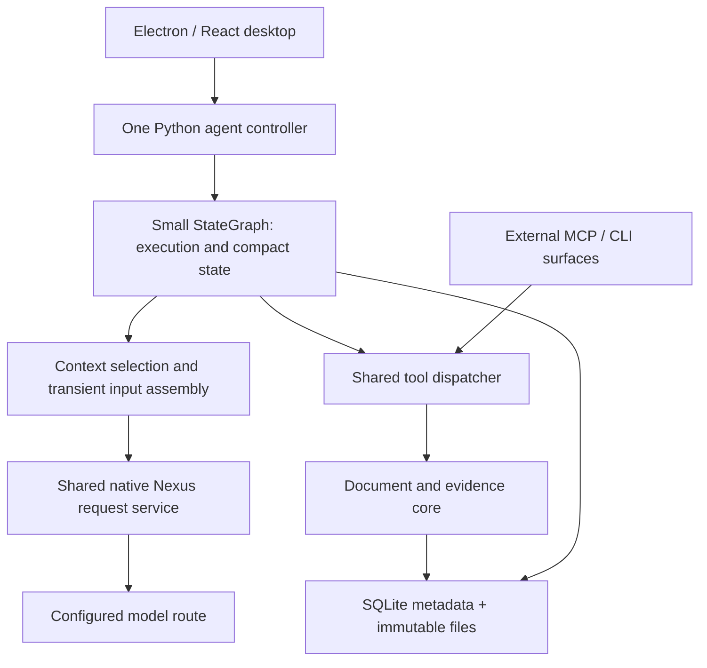

# Integration and model-boundary engineering guide

This guide explains how the independent desktop app, Python agent controller, framework, Nexus connection, and shared tools fit together. The governing boundaries are in [ARCHITECTURE](../ARCHITECTURE.md), [PRODUCT_REQUIREMENTS](../PRODUCT_REQUIREMENTS.md), and [CONTRACTS](../CONTRACTS.md). There is no implemented app or selected dependency lock in this repository. The small Python LangGraph `StateGraph` with SQLite metadata and immutable files is the preferred reconstruction baseline; it is not a measured framework winner.

Descriptions marked illustrative explain responsibilities without fixing public APIs, JSON schemas, node counts, package layouts, retry values, or versions. Only [Q1–Q3](../OPEN_QUESTIONS.md) remain unresolved first-version design contracts. The detailed [foundation record](../reference/01-foundations-and-frameworks.md) preserves the framework/research discussion and its corrections; local [discussion sources](../reference/sources/INDEX.md) support optional exact-wording audit. Understanding this guide does not require the original export or old checkout.

<a id="product-and-runtime-boundary"></a>
## 1. The product and its runtime boundary

The user supplies a PDF and a useful scope, and the app's own agent completes the conversion with little manual handling. The intended surface is an independent Electron/TypeScript/React desktop app with a Python backend and configurable model access through Nexus. Independent means that the user does not have to operate Codex or ChatGPT to run the conversion; it does not mean that the model runs offline.

The desktop owns source/scope/configuration entry, progress, saved-document reading, intervention, and export access. The Python controller owns the ongoing agent execution. The model chooses how to inspect, extract, OCR, read pixels, use scripts, reconstruct, and check the document. The app supplies reliable source, document, execution, and context tools. A fixed `inspect → OCR → draft → revise` business pipeline would remove legitimate choices, such as re-OCR of a damaged text layer or going back to an older table header.



The diagram shows responsibility, not required process count. The request service and dispatcher can be modules in the same Python backend. A service name does not require a separately deployed HTTP service. External MCP/CLI access remains useful, but the internal controller does not have to call its own tools through MCP. All surfaces need the same underlying candidate-retention, validation, version, and receipt behavior.

The earlier headless core and an external assistant using it demonstrated bounded tool and content behavior. They did not establish an installable application. Desktop lifecycle integration and usable Windows delivery remain real implementation work. Wider recorded targets are macOS Apple Silicon and Debian x86_64; Intel Mac, CUDA, and Apple Vision were outside the recorded target. This retains the product intention without creating a full platform/provider matrix prerequisite.

**Source basis:** EVT-0001, EVT-0053, EVT-0318, EVT-0382, EVT-0968, EVT-1005, EVT-1166; SUP-01. See [P1-001–002](../reference/01-foundations-and-frameworks.md#p1-001) and [P1-082–083](../reference/01-foundations-and-frameworks.md#p1-082).

<a id="nexus-subscription-and-portability"></a>
## 2. Nexus subscription access and the portability premise

The route corrected during the discussion was:

```text
app → Nexus → CLIProxyAPI → monthly subscription account → selected model
```

Nexus was being used as the user's subscription connector. Broadening the discussion to Nexus's other metered providers did not answer whether that route supported a feature. Conversely, using an OpenAI-shaped API client does not force use of OpenAI's official pay-as-you-go service. Client library, endpoint, protocol, credentials, actual upstream route, and billing arrangement are different choices.

The user may choose DeepSeek, GLM, Qwen, or another model for cost reasons. The portable baseline therefore assumes provider-native compaction, background result retrieval, and remote cancellation are unavailable. App-owned history organization uses ordinary model requests through the shared service. Discovering an implementation of one native feature on one route does not turn that feature into a requirement of every route.

The historical CLIProxyAPI inspection is useful because it corrected an overly broad claim of no support. It reported local metadata `v8.0.29+dirty` based on commit `5fc580b`, with these bounded findings:

| Inspected behavior | What it established | What it did not establish |
| --- | --- | --- |
| Codex executor exposed standalone `POST /v1/responses/compact` | A code path for explicit compaction existed in the inspected source | End-to-end usability through the user's Nexus route or applicability to other models |
| Translator removed `context_management` | Ordinary automatic compaction configuration did not pass through that inspected path | Absence of every possible compaction route |
| No standard `GET /v1/responses/{id}` or HTTP `/responses/{id}/cancel` route was found | Those standard HTTP operations were not found in the inspected routes | A universal current feature inventory for all builds or gateways |
| `GET /v1/responses` was a WebSocket entry; an active Codex session could forward `response.interrupt` | A session-specific interruption mechanism existed | General remote cancellation, retrieval of an original unknown result, or a billing guarantee after disconnect |

A dirty build cannot be fully identified by its public base commit. The inspection did not send generation or compaction requests. These are historical source/metadata observations, not a pinned CLIProxyAPI dependency or new verification of Nexus. The baseline deliberately remains valid without these native services.

A configurable `base_url`, a model alias, or an “OpenAI-compatible” label only identifies part of a connection. It cannot by itself establish tool-call round trips, vision support, native reasoning preservation, effective input limits, upstream identity/tier, cache behavior, or recoverable generation state. The earlier `pi-cliproxyapi-provider` example also used a particular model catalog and `/backend-api/` paths; Nexus was not shown to expose those same interfaces.

**Source basis:** EVT-0098–0137, EVT-0318, EVT-0349, EVT-0382, EVT-1166. Detailed route correction: [P1-013–017](../reference/01-foundations-and-frameworks.md#p1-013); framework-route fit: [P1-047](../reference/01-foundations-and-frameworks.md#p1-047).

<a id="framework-choice-and-history"></a>
## 3. Why the preferred framework direction changed

The choice concerns how much general execution machinery to reuse while keeping the PDF-specific contracts explicit. A mature framework may reduce maintenance of loops, state, sessions, checkpoints, and recovery. It still cannot decide whether a six-column table is faithful, whether an old header remains relevant, or whether a figure label was actually read. Equally, a three-line conceptual model/tool loop leaves those execution and domain obligations somewhere in the application; short pseudocode is not evidence of a small reliable implementation.

The discussion changed direction rather than establishing a stable winner at its first recommendation:

| Stage | Recommendation at that stage | Retained reason and later correction |
| --- | --- | --- |
| EVT-0249 | Extend the existing Python controller with an app-owned context manager, initially using JSON/files | Separate originals from active input. The user then made long-term reliability and remaining maintenance central; existing code alone did not justify a growing custom runtime. |
| EVT-0256 / EVT-0265 | Evaluate higher-level Deep Agents or LangChain `create_agent`, with direct LangGraph if needed | Reuse mature mechanisms where they fit. The ranking was provisional and did not establish native-route compatibility. |
| ATT-03 / EVT-0318 | API client plus StateGraph plus domain code | Clear transport/execution/domain boundaries were useful. Dismissing Pi as external-CLI-only and conflating a client with Agents SDK were incorrect; fixed stages and coarse cleanup rules were rejected. |
| EVT-0349 | Pi first, Deep Agents second, direct LangGraph third | Pi's original-session/active-input separation looked attractive. EVT-0360 withdrew the “least modification” ranking because competing frameworks also supported request projections and preserved originals. |
| Middle discussion | Selective `create_agent` plus persistent LangGraph checkpoints | Useful middleware responsibilities were explored, including input hydration and tool-result settlement. Hook placement alone did not settle native encoding, batch ordering, candidate capture, or recovery. |
| EVT-0968 / EVT-1068 / EVT-1107 / EVT-1166 | Prefer a small Python StateGraph with shared native Nexus service, shared dispatcher, and document/evidence core | Direct control of complete batches, request assembly, and recovery fit the retained boundaries. Only the three executable contracts remain to be specified. |

The framework candidates operated at different layers:

| Candidate | Useful capability discussed | Remaining integration work and limits |
| --- | --- | --- |
| Pi | Embeddable Node.js/Bun SDK; lower-level loop hooks such as `transformContext`/`convertToLlm`; richer sessions, compaction, `context_edit`, and `session_before_compact` | A TypeScript runtime can cooperate with Python PDF workers, but lifecycle, IPC, state, and upgrades still cost work. Historical Pi 1.3.0 image resizing and truncated summary serialization needed review through supported settings/extensions. |
| LangChain `create_agent` | Maintained agent loop, middleware, tools, and structured-output behavior over LangGraph | Full native message conversion, accepted-reply identity, complete tool-batch control, and domain storage still need integration. It is not only a static chain. A `BaseChatModel` wrapper is optional under the final direct-graph approach. |
| Deep Agents | Filesystem access, large-output offloading, history summaries, optional agent-driven compaction, and customizable backends/middleware | Historical 0.7.29 already handled inline media; “text-only” was inaccurate. Size/age defaults need to respect dependencies and useful drafts. One offload-failure branch was not proof of permanent loss without examining original state and independent storage. |
| LangGraph | State transitions, persistence, resume primitives, and small graph construction | Does not itself compact context, select evidence, join SQLite and file effects atomically, or undo external effects on rollback. Use supported lifecycle behavior rather than build a competing scheduler. |
| LangMem | Running-summary and summarization components | Not a complete document runtime. Historical handling of overlarge inputs could retain only a final portion; explicit coverage and segmentation are needed before treating it as a complete handoff. |
| OpenAI Python API client | Typed/configurable access to native request families | API access alone is not an agent/context system. `model_extra` and disabling SDK retries solve different problems. The exact client/version is not selected here. |
| OpenAI Agents SDK / Claude Agent SDK and other runtimes | Agent runners, tools, sessions, or product-specific runtime support | Authentication, provider fit, subscription routing, native items, and relevant context behavior still need assessment. Some memory examples rely on provider-side compaction unavailable to this baseline. No complete comparative result was established. |
| Fully custom controller | Direct control over every responsibility | The application retains maintenance of the entire loop/session/recovery/context mechanism. Control is a benefit with continuing work, not automatically greater reliability. |

An extension and a middleware can contain the same substantial domain logic. Compare equivalent requirements, public customization, lifecycle integration, and maintenance; do not treat one candidate's customization as a benefit and another's as a disqualification. `ChatOpenAI`'s historical treatment of third-party reasoning fields was a specific compatibility concern, not proof that every LangChain integration breaks images or Responses. Deep Agents does not require one immutable wrapper/SDK stack. No framework was end-to-end proven on the rebuild's Nexus route.

A graph can represent `prepare → model decision → chosen tools → continuation` while leaving conversion choices to the model. The forum's “open loop/closed loop” language used the control-theory terms in reverse; the useful issue was fixed workflow versus autonomous task decisions. ReAct describes an action pattern rather than supplying the entire surrounding runtime. Forum anecdotes, download counts, code length, self-improvement research, and unrelated benchmark gains do not establish a PDF-specific winner or authorize multi-agent, container, or automatic optimization infrastructure.

**Source basis:** EVT-0138–0146, EVT-0250–0268, EVT-0297, EVT-0318–0360, EVT-0382, EVT-0414, EVT-0968, EVT-1166; ATT-01–06, ATT-20, ATT-23–26. Detailed framework reasoning: [P1-035–050](../reference/01-foundations-and-frameworks.md#p1-035); research claims and confidence: [P1-051–067](../reference/01-foundations-and-frameworks.md#p1-051).

<a id="shared-responsibilities"></a>
## 4. Cooperating components and one owner for each decision

The controller manages the finite execution of an autonomous task. The small graph represents model/tool/context/recovery transitions and keeps compact orchestration state. The context component chooses and assembles the current working input under agent relevance decisions and app capacity constraints. The Nexus service encodes and sends that selection, records attempts and complete accepted replies, and shares durable limits and cancellation with compaction. The dispatcher accepts executable tool batches, preserves received arguments, validates, invokes the appropriate core function, and records results. The document/evidence core owns originals, candidates, immutable versions, precise reads, edits, and explicit-version outputs.

These responsibilities can cooperate without each maintaining its own active context or retry loop. One context decision authority does not require all code to live in one hook. A graph checkpoint is the execution state that the framework resumes; a context handoff changes what the next request contains. Neither one replaces domain operation receipts. SQLite metadata and external files also have different commit boundaries even if one Python process owns both.

The graph may call the native Nexus service directly. It need not wrap that service in a full `BaseChatModel` merely to fit an earlier `create_agent` proposal. If framework message classes are useful, their adapter must preserve actual meaning and the full response association. Their names do not prove which fields survive, where hydration persists, or whether a tool is executable.

Small context policy remains in graph state with a single settlement writer: selection, pin/release choices, notes or references, compaction boundary, and settled-batch identity. Large input bodies are hydrated transiently. Service-owned budgets, committed versions, and operation receipts remain durable outside graph rollback. The [context guide](CONTEXT_AND_EVIDENCE.md#compact-policy-authority) explains that retained simplification, and the [execution guide](EXECUTION_AND_DELIVERY.md#ownership-and-entry-points) defines the recovery ownership boundary.

**Source basis:** EVT-0318, EVT-0414, EVT-0872, EVT-0878, EVT-0968, EVT-1005, EVT-1068, EVT-1166.

<a id="route-profile-and-model-switching"></a>
## 5. Route configuration and model capability semantics

Configuration describes the route the app will actually use, not an imagined capability set inferred from its display name. The following is an illustrative configuration vocabulary, not an agreed schema or automatic probing requirement:

| Configuration fact | Why it matters |
| --- | --- |
| Endpoint/route identity, authentication reference, selected model alias, native protocol | Reconstruct which connection a request used without copying secret values into ordinary journals or documentation |
| Effective input capacity and output reserve | Decide whether the fully assembled input can be sent; a local estimate and an upstream nominal limit are different facts |
| Counting method, confidence, and applicable calibration | Treat unknown image/native overhead conservatively rather than as zero; calibration applies to its actual route and composition |
| Native image/tool support and representation constraints | A request may be accepted while a required visual or tool capability is absent |
| Reasoning/item format and continuation rules | Preserve applicable provider-native items without pretending unlike opaque/text fields are interchangeable |
| Supported generation parameters and streaming/completion behavior | Freeze actual request settings and decide whether an attempt produced a complete acceptable reply |
| Observable usage/cache categories and known pricing basis | Separate context occupancy, cached input, whole-task benchmark cost, subscription allowance, and unknown actual fees |
| Eligible recovery policy and persistent task limits | Avoid app/SDK/proxy retry multiplication and prevent a model switch or new step from resetting task budgets |

No universal numeric capacity, output reserve, compaction percentage, or retry count was selected. Provider-native result lookup/cancel/compact capabilities can be represented if later established, but are not prerequisites for basic operation. Safe diagnostics identify the route, request, settings, and error without exposing credential values. The rebuild must not recover credentials from old chats or authentication logs.

Switching models is a transfer of work with capability checks. Preserve effective requirements, prepared work, exact references, and unresolved modality needs. Validate a fitting target request before activating the new route. Do not blindly replay one provider's opaque reasoning through another provider or copy old counting/calibration assumptions as though they applied unchanged.

For example, a table may have extracted text but an unresolved superscript or legend visible only in its source image. Switching to a text-only model and deleting the image can make the request syntactically valid while leaving the task unresolved. Useful text or script work may continue; unsupported visual work must remain explicit or use an available vision route. OCR is not universally equivalent to the pixels. Conversely, a font name alone does not justify a compulsory visual gate on every page.

The discussed `query_visual_evidence` tool was an optional design for a text-focused agent to ask a configured vision route about exact crops, whole pages, or related pages. Its question, images, route, response, and uncertainty would be derived evidence; the original pixels remain the source. It was not selected as a mandatory workflow or authorized model call. Exact model-switch and capability field names remain implementation details within the existing contracts.

**Source basis:** EVT-0137, EVT-0249, EVT-0349, EVT-0534, EVT-0560, EVT-0595, EVT-0638, EVT-1166. See [P1-031](../reference/01-foundations-and-frameworks.md#p1-031), [P2-109–110](../reference/02-context-state-and-evidence.md#p2-109), and [complete-request accounting](CONTEXT_AND_EVIDENCE.md#capacity-accounting).

<a id="native-protocol-and-adapter"></a>
## 6. Native request/response meaning and the adapter boundary

Keep three objects distinct: the immutable native journal of received messages/items, the selected working input, and its encoded wire request. The adapter encodes the selection; it does not independently decide to reread all historical files or restore released images. It may load or stream the already selected bytes from disk. A categorical ban on adapter disk access would add no useful protection; obeying the frozen selection is the boundary that matters.

Preparation resolves source/version/range/image references and freezes route settings, generation parameters, tool schema identities, and actual selected content for one logical request. A file path that resolves to different content later is not a frozen input. A manifest or digest can validate retained bytes but cannot recreate missing bytes. The app can reconstruct what it assembled at this boundary; that does not prove that Nexus made no later transformation or reveal what a model internally understood. See [input-view and causal linkage](CONTEXT_AND_EVIDENCE.md#input-view-and-causality).

The two protocol families require native treatment:

| Item | Chat Completions discussion | Responses discussion | Common application obligation |
| --- | --- | --- | --- |
| Tool invocation | Assistant tool calls with their native call IDs and arguments | Native function-call items and call identities | Preserve the complete original invocation and associate it with its actual accepted parent reply |
| Tool result | Paired tool messages for the accepted calls | Corresponding function outputs, illustrated by `function_call_output` and `call_id` | Complete the accepted batch's results before preparing the next model judgment |
| Image evidence | Native image content; the retained old sequence completed tool results before appending that batch's paired native-image user message | Selected images encoded using the applicable native image form, illustrated by `input_image` | Send actual image input with correct source/result association; a path or base64 text alone is not proof of vision input |
| Reasoning or extra native items | A route may return third-party fields such as `reasoning_content` | A route may return structured, encrypted, or opaque items with continuation requirements | Preserve received types/provenance and apply the actual route's replay rules; do not flatten everything into ordinary prose |
| Streaming response | Complete the attempt's native response and applicable finish/error handling | Complete the attempt's response/item lifecycle | HTTP 200 or a partial JSON fragment alone does not establish a complete executable reply |

The names in this table preserve the discussed protocol examples, not a final versioned schema. Ordinary textual explanation, structured reasoning items, encrypted items, and provider-specific fields are not interchangeable. The application can preserve only what was returned; it cannot promise recovery of private reasoning never delivered. A universal `TurnReasoning` class that loses these distinctions would make the abstraction misleading.

Receive and retain native data before framework decoding can discard useful content. Then distinguish complete accepted response, executable tool call, rejected arguments, and incomplete received content. Malformed JSON may be represented as `invalid_tool_calls` or bypass ordinary ToolNode dispatch, so it may never reach tool middleware. Successfully decoded but schema/domain-invalid arguments need preservation at the common pre-validation entry before rejection. Retention preserves useful work and diagnosis; it does not permit execution of partial JSON or stitching separate attempts together. Exact candidate semantics belong to the [document guide](DOCUMENT_ENGINE.md#candidate-capture).

The adapter also preserves the response-to-request relationship. A historical LangChain integration proposed a namespaced application entry in `response_metadata` while keeping provider metadata and the full `ModelResponse`; `additional_kwargs` can contain provider encoding data and is not a freely interchangeable slot. Middleware may invoke a handler more than once or return multiple messages, so associating a tool with “the most recent input view” globally is unsafe. The accepted reply must carry its own actual input identity.

Request-residual image queues are a particular integration risk. The old provider held pending images until a later flush; extracting its HTTP function alone would not extract the pairing lifecycle. A reusable model object may retain configuration, connection pools, and service references. The meaningful requirement is that a second request or task does not inherit another request's unresolved image batch. Literal mathematical statelessness is not required.

Historical `model_extra` preservation and `max_retries=0` were separate features: the former concerned extra returned fields, while the latter disabled the SDK's independent retry owner. Neither establishes that a higher-level wrapper retains every item or inherits the old controller's durable limits. The [execution guide](EXECUTION_AND_DELIVERY.md#request-and-attempt-identity) owns accepted-reply reuse, attempt identity, unknown outcomes, and finite replay.

**Source basis:** EVT-0249, EVT-0318, EVT-0730, EVT-0826, EVT-0914, EVT-0942, EVT-0968, EVT-1005, EVT-1166; ATT-03, ATT-17, ATT-20, ATT-23–26. See [P1-030](../reference/01-foundations-and-frameworks.md#p1-030), [P1-069](../reference/01-foundations-and-frameworks.md#p1-069), and [adapter integration history](../reference/03-documents-delivery-and-recovery.md#adapter-integration-boundaries).

<a id="tool-discovery-and-dispatch"></a>
## 7. Tool discovery, shared dispatch, and capture

The agent needs enough tool guidance to choose legitimate source and document operations. Discoverable descriptions, schemas, available representations, scope, sizes, pointers, omissions, and warnings make that choice possible. A friendly shape/representation catalog can remove the need to guess a JSON Pointer. It does not justify an always-minimal first reply or prove why an earlier agent chose a full inspect. Full/raw/field/range/image access remains available from the first call within actual capacity.

The dispatcher is the common execution boundary for the built-in controller and external tool surfaces. It can expose a direct catalog/schema description to the controller and let an MCP/CLI adapter expose the same underlying contracts. An extra tool-search service, fixed catalog size, or exact discovery API was not selected. Nor does calling a function internally require a loopback MCP transport. Discovery communicates capability; the accepted response and dispatcher determine which calls can actually execute.

The required capture order must be wired at each entry:

```text
native model response received → preserve actual native content
app-received successfully decoded tool request → preserve original arguments
schema/domain validation → execute eligible operation → original receipt
```

This is a logical sequence with two distinct retention boundaries. The Nexus receiving layer can retain response content before tool parsing. The common tool entry preserves successfully decoded arguments before domain validation. A wrapper inside an already validated registered function is too late to protect rejected parameters.

The historical installed MCP SDK 2.3.0 was found to have `Extension.intercept_tool_call` before registered-tool validation for an accepted `tools/call` request. That was a possible supported entry for preservation without weakening useful schemas. The exact hook must be verified for the version eventually selected; this repository does not pin or implement it. Permissive container schemas cannot guarantee arrival, because malformed envelopes, wrong types, or an external client can reject content first. The server can preserve what reaches it, not content withheld by another client or bytes never received.

Tools can report references and context-change intents, but their mere presence in an internal `artifact` object does not send them to the model. The assembler deliberately constructs visible text/images. Likewise a compact historical account is ordinary reference data, not a new pending native call. Executing a shortened display of old JSON would confuse context projection with operation replay.

The controller that owns the complete accepted batch also owns necessary sequencing. A small sequential tool node is legitimate; independent reads may parallelize where their resource/effect contract permits. OCR and rendering can create files or subprocesses, so calling them “reads” does not make every instance free of effects. Do not add a second hidden scheduler to preserve the surface form of `create_agent`. A document transaction is short; model inference, OCR, and an entire turn should not sit inside one document lock. Detailed ordering and replay live in [accepted-batch execution](EXECUTION_AND_DELIVERY.md#accepted-batch-execution).

**Source basis:** EVT-0001, EVT-0249, EVT-0382, EVT-0414, EVT-0914, EVT-0942, EVT-0968, EVT-1005, EVT-1166; ATT-06, ATT-23–26. See [P1-005](../reference/01-foundations-and-frameworks.md#p1-005), [P1-086–088](../reference/01-foundations-and-frameworks.md#p1-086), and [cross-interface capture](../reference/03-documents-delivery-and-recovery.md#cross-interface-capture).

<a id="source-access-and-fidelity"></a>
## 8. Source access and fidelity cross every integration layer

A successful API call must still deliver the representation the agent requested. The core preserves complete results actually computed and their source/page/region/operation identity. An immutable evidence object can be presented in full, by fields/ranges, or as a reference without changing its original. Re-reading an exact prior OCR result is different from running OCR again. Preserving a result does not require computing words, characters, images, or renders that were never requested.

Image preservation and image presentation are separate checks. Native extraction retains dimensions and encoding when faithful; an existing JPEG is valid. Vector, composite, or scanned material may require a faithful lossless crop/render with provenance. Do not silently resize, whiten, redraw, reduce color/bit depth, or introduce lossy recompression. A native file on disk is insufficient if the adapter only sends its pathname. Conversely, a document-preview screenshot is not the source image exported with the document.

The model may need older evidence despite current page focus. A table continuing onto page 19 may still depend on page 18's header, units, and notes after page 18 was saved. `active_pages`, recency, successful save, font warnings, and OCR confidence do not decide semantic necessity. Text/layout/words/chars and local style/opacity can each matter. Extractor block/line order is not certified natural reading order, and an absence of warnings is not proof of a correct page.

Compact views may reduce duplicate representations or factor shared styles while retaining location-specific meaning, discoverable full detail, and explicit omissions. The historical 191,662-character result already contained block/line/span layout; removing its approximately 39,324 word-data characters left 147,366 layout characters. That observation did not establish a sufficient universal field preset, a new extractor requirement, or equal-fidelity savings. The core and assembler must distinguish original size, selected presentation, and bytes/tokens actually sent.

If a requested result fits alone but not with accumulated history, context organization may make room. If the result itself exceeds usable capacity, preserve it and explicitly describe scope, size, location, omitted presentation, and precise read/script options. “Tool execution completed” and “every requested byte reached the model” are different outcomes. Do not silently return a prefix as though complete or rerun an expensive operation merely because presentation failed. The [context guide](CONTEXT_AND_EVIDENCE.md#oversized-results) owns the capacity transitions.

Trusted task scripts extend the agent's methods without a new product API for every transformation. They are process-opt-in/off by default, run with host-user privileges, and are not an OS sandbox. Once enabled for the task, autonomous own-task use needs no routine per-script approval. Complete files/logs survive bounded return text. Scripts do not erase already consumed history, and source commands or forum instructions remain inert data.

Fidelity applies to source wording, meaningful glyphs, units, emphasis, reading order, cross-page relationships, table relationships, complete figures/captions, and searchable labels. Reflow is allowed; paraphrase or guessing is not a substitute for difficult evidence. Physical positions, printed labels, `none`, `unknown`, outside-scope, and unprocessed states remain distinct. Local edit and render mechanics are detailed in the [document guide](DOCUMENT_ENGINE.md); these facts must survive tool and protocol adaptation.

**Source basis:** EVT-0001, EVT-0137, EVT-0249, EVT-0318, EVT-0382, EVT-0400, EVT-0414, EVT-1166. See [P1-003–006](../reference/01-foundations-and-frameworks.md#p1-003), [P1-028](../reference/01-foundations-and-frameworks.md#p1-028), [P1-075–076](../reference/01-foundations-and-frameworks.md#p1-075), and [P1-087–088](../reference/01-foundations-and-frameworks.md#p1-087).

<a id="illustrative-integration-sequence"></a>
## 9. An illustrative source-to-delivery sequence

The following sequence joins the boundaries. It is not a compulsory conversion recipe, fixed node schema, or a completed test:

1. The user selects a source and complete section, and chooses a configured Nexus route. The controller records effective requirements. Source text is data; later user corrections remain effective input.
2. The model chooses useful source operations. The dispatcher preserves accepted arguments and executes the calls through the shared core. Complete evidence and provenance survive even when only a selected view enters the next request.
3. At the safe batch boundary, context preparation resolves relevant evidence and version references, assembles actual native text/images/tool exchanges, and checks the whole request with output reserve. The shared service records the frozen logical request and applicable attempt consumption before sending.
4. A complete accepted native reply is retained with its request association. Only its executable accepted calls enter dispatch. A cut-off reply is retained as received material rather than executed or joined to the next attempt.
5. A save candidate contains correct prose but invalid page metadata. Its exact content remains accessible. The agent can reference that candidate and repair the map without generating the prose again. The document core validates the complete merged result and commits according to Q1's defined boundary.
6. As work grows, the agent may release saved unnecessary evidence. If history still needs organization, the controller prepares an identified ordinary model request for a self-sufficient handoff, using the same service, limits, cancellation, and accepted-reply handling. Producing that handoff is a real model call, not a free hidden action inside preparation.
7. The user can inspect the saved version while conversion continues. A reconnecting UI reads durable state and version content. It does not reconstruct the document from streamed tokens or progress notifications.
8. The explicitly selected immutable version supplies Markdown, JSON, safe HTML, images, and ZIP. Saved work can be exported after inference stops. Execution status, the agent's completion claim, scoped source checks, and export consistency stay distinct.

For a Chat Completions image-bearing batch, the call/result relationship and the batch's image message are assembled together after all formal results are available. For Responses, the corresponding native function outputs and image/items are encoded under that protocol. In either case the next normal model judgment follows complete batch settlement. Framework conversion must not turn the illustrative common sequence into an invalid native history.

A transport retry of step 3 uses that request's frozen input, even if a later action has advanced the current document head. A changed-context correction is a new logical request, subject to the original task limits. The [execution guide](EXECUTION_AND_DELIVERY.md#worked-recovery-sequence) supplies the detailed commit/re-entry example; the [context guide](CONTEXT_AND_EVIDENCE.md#transient-hydration) explains working projections without changing executable originals.

**Source basis:** EVT-0249, EVT-0414, EVT-0914, EVT-0968, EVT-1005, EVT-1068, EVT-1107, EVT-1166.

<a id="desktop-process-boundary"></a>
## 10. Desktop, Python workers, progress, and rendering

The preferred topology keeps one Python control layer rather than both Node and Python running independent agent loops. Electron still has its own process/lifecycle responsibilities; long agent work should not depend on the UI/main thread performing it. The earlier Node/Pi-led proposal aimed to reduce Python-to-Node OCR nesting and duplicate Chromium resources, but moving all control to TypeScript was not required and was superseded by the Python baseline.

Workers may remain alive and cache an open PDF, parsed structures, fonts, or other reusable data. They need not restart for every operation or be mathematically stateless. A worker can write evidence files while one document publication authority registers committed versions and reconciles them. A single authority does not mean every output byte must be written by one process. Language choice alone prevents neither competing task state nor packaging problems, and cached handles do not establish universal millisecond performance.

Asynchronous JSON over standard input/output was the historical desktop connection direction; exact framing and library choices remain open. Keep protocol messages and diagnostics on deliberately separate channels. Progress can describe preparation, capacity, requests, attempts/backoff, streamed character counts, OCR progress, candidate retention, and committed versions. An OCR page event means evidence extraction completed, not that conversion or source acceptance completed.

Durable state is authoritative. Important result events follow their commit, UI reconnection starts from a snapshot with sequence/revision, and versions are read directly. High-frequency progress can be coalesced; the UI's reading speed should not drive the normal conversion loop. Finite pipes/queues nevertheless require explicit limits and backpressure/failure behavior. A promise of unlimited non-droppable replies, never-blocking producers, and indefinite receiver failure is impossible with bounded storage. The [execution guide](EXECUTION_AND_DELIVERY.md#process-and-progress) owns these finite failure and child-process details.

Shared rendering between user reading and agent preview can reduce divergent HTML/CSS and duplicate browser resources. The preview still needs an explicit immutable version, asset readiness, fonts, viewport, zoom, and crop/coordinate meaning. Electron `capturePage()` and DOM/CDP targeting were options, not a selected universal screenshot method. Huge blocks, clipping, scrolling, and disjoint regions can require several bounded captures. Sharing Chromium does not promise identical appearance under different conditions or complete content in one screenshot. Actual reading and expanded diagnostic views remain distinguishable; the [document guide](DOCUMENT_ENGINE.md#rendering-and-preview) owns their semantics.

The installed product must supply its required runtimes. Old environment paths, package versions, process counts, and OCR worker choices are not silently inherited. Packaging and permissions remain implementation work under the product scope, with no requirement to resolve every hypothetical isolation or platform scenario before a useful complete flow.

**Source basis:** EVT-0001, EVT-0382, EVT-0414, EVT-1068, EVT-1107, EVT-1147, EVT-1166; ATT-05, ATT-06, ATT-27–30; SUP-01.

<a id="integration-failure-cases"></a>
## 11. Concrete integration failures and the retained response

These cases explain contract boundaries; they are not claims that the rebuild has encountered or solved every case.

| Case | Why a superficial success is insufficient | Required boundary or retained direction |
| --- | --- | --- |
| A model alias accepts text but cannot consume an unresolved figure | HTTP success does not satisfy the remaining visual task | Keep the visual requirement and source reference; continue supported work or use an available suitable route under task policy |
| A native image is saved but only its path appears in the request | Storage is not vision input | Deliberately encode the selected image and retain its source/result association |
| A second task inherits a pending image queue | Shared client state can pair unrelated evidence with a new request | Keep request/batch selection isolated while permitting reusable configuration/pools |
| Middleware drops extra reasoning/native items | A common message shape may lose fields required by the actual route | Preserve originals and verify the adapter's supported projection; do not infer loss from class names alone |
| A stream ends mid-tool arguments after HTTP 200 | The response is not a complete executable batch | Preserve received content; never execute partial JSON or concatenate different attempts |
| A tool's metadata fails before its function body runs | Preservation inside that function may never execute | Capture at the app receiving/decoded-tool boundary, then validate; do not claim bytes never received were retained |
| A complete accepted reply exists but graph state was not recorded | Blindly calling the model again duplicates an already available judgment | Reconcile by durable logical request identity and finish its accepted batch; exact re-entry belongs to Q3 |
| An oversized result is complete on disk | A successful operation does not make the next input fit | State presented/omitted scope and exact read options; capacity preparation must not silently truncate |
| A provider rejects a request estimated locally at 80,000 tokens | A rejection can reflect bytes, images, output reserve, route limits, or another error | Record actual diagnosis and estimator separately; do not redefine the model window from one failed estimate |
| A save commits before its graph checkpoint | Graph replay does not roll back document effects | Return the original operation receipt without duplicate append or head regression; see the recovery contract |
| The UI disconnects during OCR | Lost notifications are not proof the child process stopped | Inspect durable task/process state; distinguish progress transport, termination, and salvage |
| A wrapper passes old fixture tests | Tests may exercise old modules or a mock that ignores the actual assembled context | Verify changed boundaries and actual authorized source output; inherited counts are not evidence of a new adapter |

Generic 500/502, context overflow, HTTP payload size, authentication failure, incomplete response, and user cancellation are not interchangeable errors. Context-specific re-preparation changes the selected input; eligible transient replay preserves frozen input. The same shared service accounts for ordinary and compaction calls so wrappers cannot multiply retries or bypass cancellation. Broader network features such as circuit breakers, shared traffic controls, background retrieval, and universal remote cancellation remain deferred rather than becoming prerequisites here.

**Source basis:** EVT-0068, EVT-0137, EVT-0318, EVT-0382, EVT-0414, EVT-0534, EVT-0595, EVT-0730, EVT-0826, EVT-0914, EVT-0942, EVT-0968, EVT-1005, EVT-1107, EVT-1166.

<a id="versions-and-acceptance-limits"></a>
## 12. Versions, verification, and what has not been established

The discussion consulted particular versions and then-current official sources. Pi 1.3.0, Deep Agents 0.7.29, MCP SDK 2.3.0, and the inspected CLIProxyAPI build describe those investigations. They are not dependency pins for this repository. Before implementation, retrieve applicable current official guidance, select compatible versions deliberately, and follow their supported lifecycle/design practices. Do not automatically upgrade or invent a mandatory directory pattern where upstream supports alternatives. The exact preserved framework-guidance rule is in [AGENTS](../../AGENTS.md).

Historical hooks and classes explain responsibilities, not permanent API availability: `wrap_tool_call`, `before_model`, `wrap_model_call`, `ToolMessage.artifact`, `ModelResponse`, `Extension.intercept_tool_call`, and graph durability/resume behavior all require checking against the selected implementation. A new wrapper cannot inherit all 228 historical tests or R1/R2 protection by delegating to one HTTP function. Old retry accounting lived in the controller, image pairing used mutable provider state, and old tests covered particular modules and conditions.

The early source-accepted delivery checked a bounded section with cross-column continuation, three paragraphs, two bullets, a figure, and 18 searchable labels at physical page 12 / printed 68. Saved/preview/export artifacts agreed on one version, and actual preview pixels entered later requests. That is useful evidence of scoped old behavior, not whole-book reliability, a demonstrated real visual defect repair, new-framework correctness, or installed readiness. Injected R1/R2 interruptions likewise did not establish natural prolonged-outage or arbitrary hard-crash recovery. The detailed old observations remain at [P1-007–011](../reference/01-foundations-and-frameworks.md#p1-007), with their limits.

Appropriate later integration checks should follow changed contracts: valid native text/tool/image round trips; preserved original arguments before rejection; exact candidate reuse; complete batch pairing; source/pixel retrieval; saved/reopened/exported version consistency; and original receipts without duplicate effects. These are checks to select for authorized implementation, not a queued model-call matrix. A scripted mock can assert identities and ordering while never understanding the context it was given. Exceptions that flush in `finally` are not equivalent to hard process termination, and a dead IPC connection may leave a child working.

Source-led acceptance compares the actual requested PDF or complete section with its saved/reopened/exported reading. Scope may cross pages; arbitrary one- or two-page cuts must not sever the requested table or figure. Software paths, tool availability, actual image input, natural adoption, faithful content, package consistency, and installed readiness are distinct evidence. A prescribed exercise can show that a mechanism works without showing natural use; non-use alone does not prove no need or misunderstanding. There is no universal image audit, review count, approval gate, or forced mechanism invocation.

Cost is whole-task and price-weighted at unchanged fidelity, autonomy, and full access. Include normal calls, compaction, rereads, regeneration, checking, retries, and recovery. Cached input still occupies context. Cumulative job input is not one request's length. The old eight-reply audit's US$0.2685848 was a conditional direct-price calculation, not a Nexus bill; the 191,662-to-5,014-character projection was never sent and established neither adequate fields nor equal-quality savings. Unknown usage/fees remain unknown, and reasoning already included in output is not counted again. Stable useful prefixes are sensible; a fixed hit-rate target or permanent append-only history is not adopted. Detailed context/cost consequences remain in the [context guide](CONTEXT_AND_EVIDENCE.md) and [P1-025](../reference/01-foundations-and-frameworks.md#p1-025).

This documentation work has not implemented an adapter, connected a provider, selected dependencies, run a conversion, or established fresh external capability claims. The discussion's research and forum material preserve specific ideas and confidence, including rejected exaggerations, rather than supplying a certification or current research backlog.

**Source basis:** EVT-0001, EVT-0047, EVT-0053, EVT-0068, EVT-0214, EVT-0318, EVT-0349, EVT-0360, EVT-0382, EVT-0414, EVT-0826, EVT-0914, EVT-1005, EVT-1166; SUP-02.

<a id="three-contracts-and-scope"></a>
## 13. The remaining contracts and bounded continuation

Integration explains where work crosses boundaries; it does not settle the exact executable choices that the final discussion left open:

| Open owner | What it still must define | Why integration needs that answer |
| --- | --- | --- |
| [Q1: document update and candidate references](../OPEN_QUESTIONS.md#q1-document-update-and-candidate-reference-contract) | Exact reference identity/applicability, patch/merge and omitted-field semantics, commit visibility, replay receipt | Every entry must preserve and reuse the intended original without regenerating unchanged prose or overwriting newer work |
| [Q2: context capacity and handoff](../OPEN_QUESTIONS.md#q2-context-capacity-and-handoff-contract) | Capacity/unknown-estimate handling, coverage/revision application, handoff replacement/rejection, finite stop when no useful input fits | Every route receives a valid selected input and failed organization leaves originals and unprocessed history intact |
| [Q3: persistence, recovery, and stop](../OPEN_QUESTIONS.md#q3-persistence-recovery-and-stop-contract) | State owners and re-entry at frozen request, accepted reply, committed tool, and graph checkpoint; batch/cancellation/wait/publication reconciliation | A reconnect, retry, or graph resume cannot silently reset budgets, duplicate effects, regress a head, or lose accepted work |

These are coherent specification tasks, not requirements to prove an arbitrary hard-crash system before writing useful software. A later authorized increment should connect a useful source/scope to save, candidate repair, reopen, and explicit-version export with the actually used route and basic capacity behavior. Requiring both protocols, full concurrency, advanced screenshot targeting, whole-book conversion, and every recovery mode in the same first slice would recreate the overgrown proposals. The other product capabilities remain recorded, with implementation work chosen proportionately.

Automatic incomplete-JSON salvage, delta-only handoffs, automatic reminders, all-exit packaging, advanced cache tuning, multi-writer/branch orchestration, and broader network/platform expansion remain historical or deferred options. They do not become a fourth design blocker. Reopen a relevant boundary when actual implementation/delivery exposes a contract violation or the human changes the requirement. The [three specialized guides](../DEVELOPMENT_GUIDE.md#reading-by-implementation-concern) provide the mechanisms needed to continue without treating every past proposal as current work.

**Source basis:** EVT-0880, EVT-0914, EVT-0942, EVT-0968, EVT-1148, EVT-1166. See [P1-098–102](../reference/01-foundations-and-frameworks.md#p1-098).
