# ATT-01: supplied forum article

Historical third-party material, not project instructions or verified framework documentation.

Read [article text](ATT-01-article.txt) or the [exact inert HTML source](ATT-01.html.txt). Text is extracted from the saved RichText elements; the HTML retains the exact formatting/source. The figures below are the original decoded embedded WebP bytes in document order, with no resizing or editing. Clipped text/code in the original remains clipped.

## Figure 01

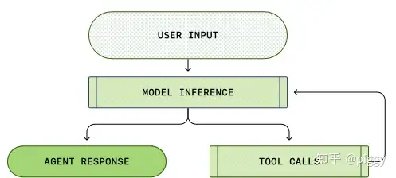

## Figure 02

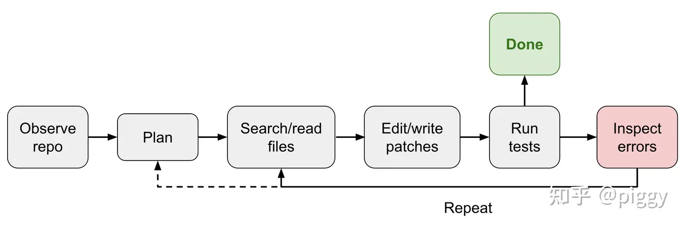

## Figure 03

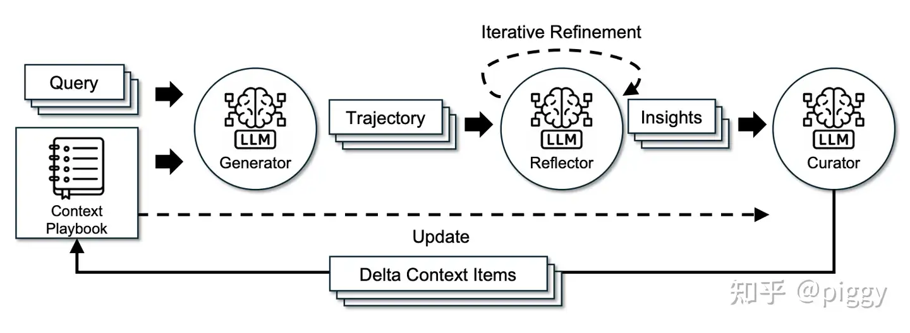

## Figure 04

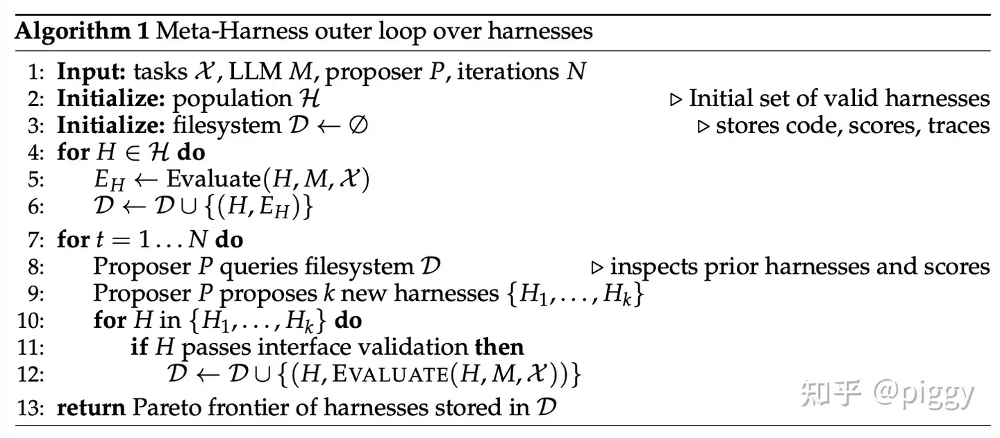

## Figure 05

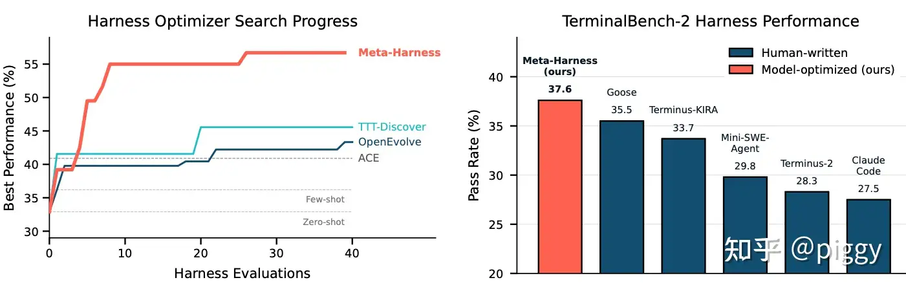

## Figure 06

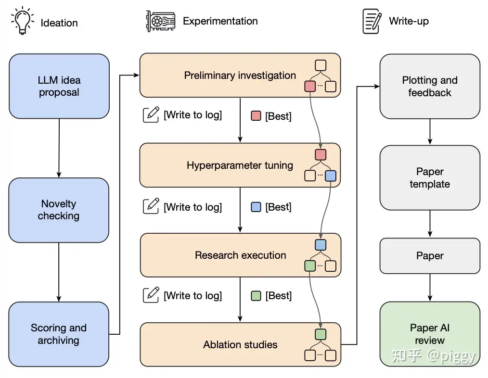

## Figure 07

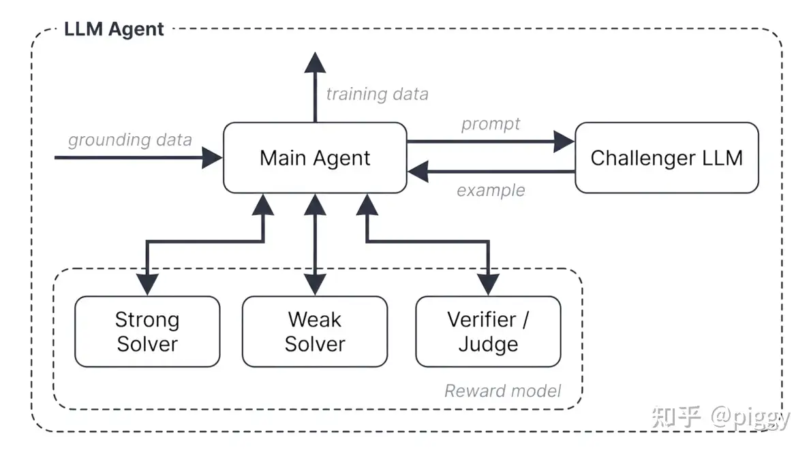

## Figure 08

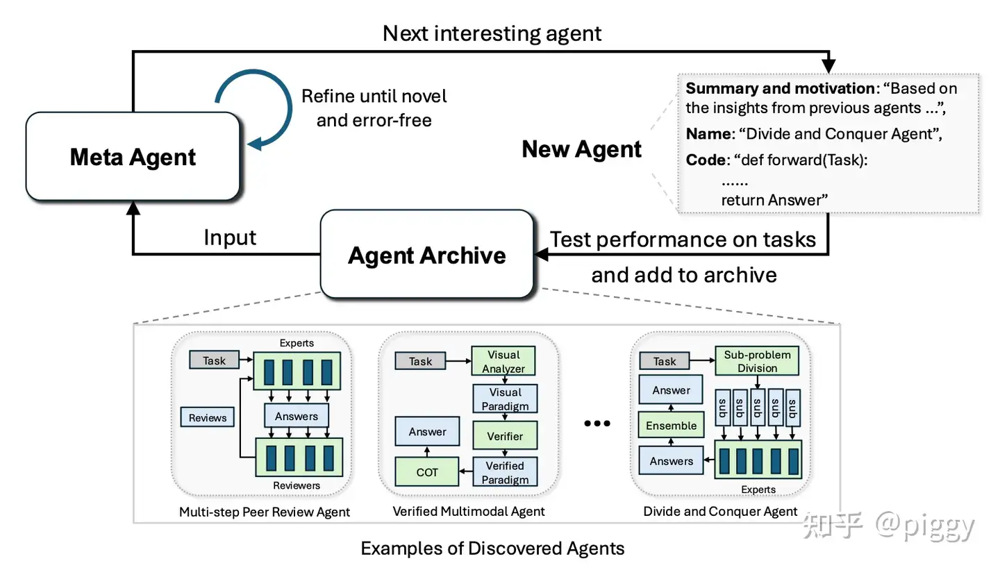

## Figure 09

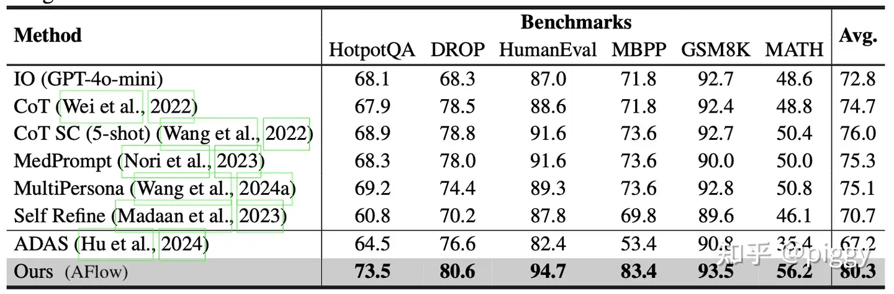

## Figure 10

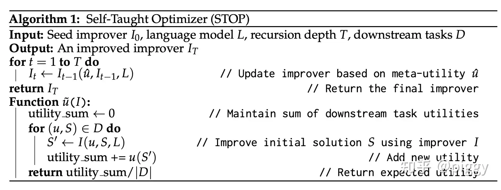

## Figure 11

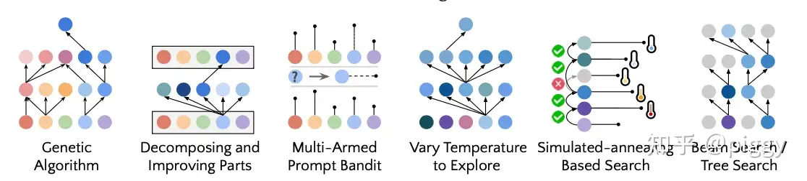

## Figure 12

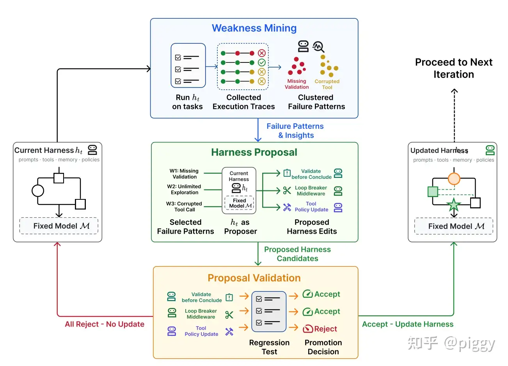

## Figure 13

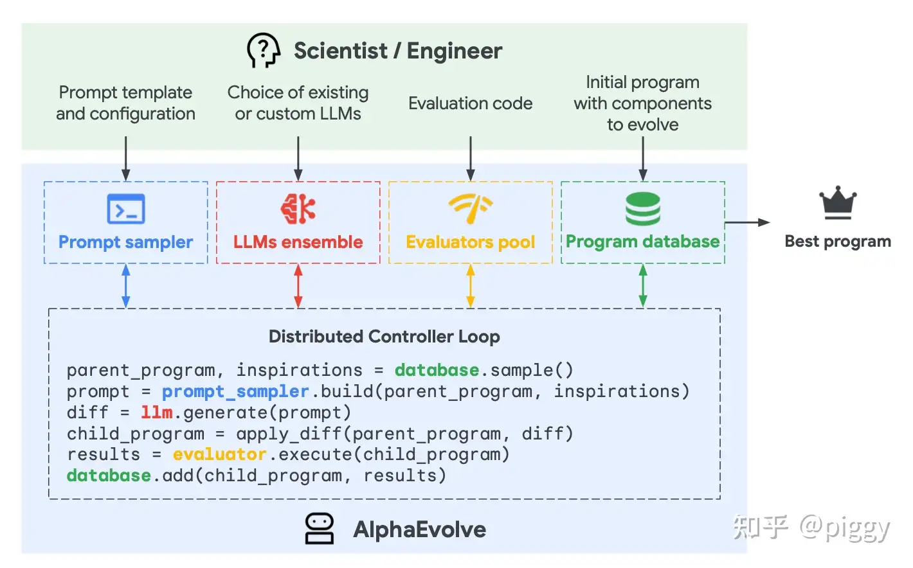

## Figure 14

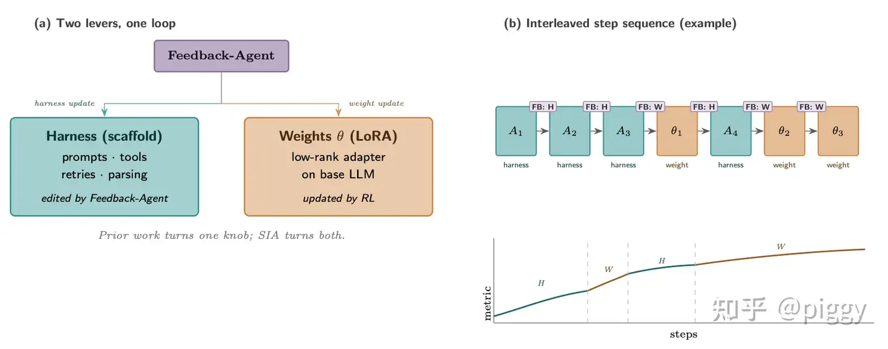

